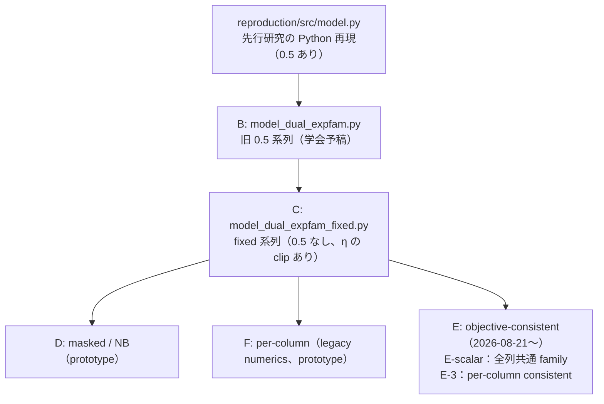

# 01 研究の概要

[← README](README.md)

## 1. 研究の目的

属性付き関係データの潜在構造モデル（Mikawa et al. 2024）を、$X$ 側と $Y$ 側で独立に指数型分布族（Gaussian / Bernoulli / Poisson）へ一般化し、
人工データと実データで、その**挙動・有効な条件・限界**を評価する（[`AGENTS.md`](https://github.com/H-T-0726/expfam-lsm-attributed-relational-data/blob/1b5030b/AGENTS.md) §1、FACT）。
**一般化が有効であることは前提にしていない。**

## 2. 元論文から何を変えたか

| 項目 | 元論文 | 本研究 |
|---|---|---|
| $Y$ の分布 | Bernoulli 固定 | Gaussian / Bernoulli / Poisson から選ぶ |
| $X$ の分布 | Gaussian 固定 | Gaussian / Bernoulli / Poisson から選ぶ（標準モデルでは全列共通） |
| E-step の Y 側の係数 | 印刷式に 1/2 がある（Eq.19/20/22/23） | 独立に再導出し、unique pair の条件付きでは extra 1/2 を持たない（意図的な差） |
| 分散パラメータ | — | $V_Y(\eta)=A_Y''(\eta)/\phi_Y$ を E-step で落とさない |
| $K$ の選択基準 | Eq.(26)（$Z$ に条件付けた尤度 + 罰則） | C_Q（Q ベース）を主に使い、C_Lap・held-out 予測なども比較 |

**拡張モデル（prototype、本文採用不可）**：列ごとに分布を変える per-column モデル、分布の自動選択、COM-Poisson（PR #129）。

## 3. 生成モデル

$$
z_i \sim \mathcal N(0,I_K),\quad
y_{ij}\sim \mathrm{ExpFam}_Y(\eta^Y_{ij}=w_0+w\,z_i^\top z_j)\ (i<j),\quad
x_{il}\sim\mathrm{ExpFam}_X(\eta^X_{il}=f_l^\top z_i)
$$

- $\theta=\{F, w_0, w\}$。Gaussian-X のとき $\Sigma_X$（対角）、Gaussian-Y のとき $\sigma_Y^2$ を追加する。
- $X$ にはバイアス（切片）がない。
- 推定は Monte Carlo EM（E-step で $Z$ を $L$ 個サンプルし、M-step で $\theta$ を更新）。

## 4. 実装系列（lineage）— 結果を混ぜない

| 系列 | 実体 | 正式モデルと同じ観測モデルか | 主な実験 |
|---|---|---|---|
| A | 原論文の印刷式 | 先行モデル | — |
| B | `model_dual_expfam.py`（0.5 あり） | 同じ | 学会予稿の Exp1–4 |
| C | `model_dual_expfam_fixed.py` | 同じ | fixed official Exp1–4、Wine・旧 Cora・MovieLens |
| D | masked / NB | masked は同じ、NB は範囲外 | strict held-out の基盤、過分散 |
| E-scalar | `DualExpFamLSMConsistent` | 同じ（数値計算は clip なし） | Phase 7e/8b、clean n-sweep、K-exp2、CORA-SH1 |
| E-3 | `DualExpFamLSMPerColumnConsistent` | **範囲外**（列ごとに family） | M1、E1、AF、Phase 9、混合 X |
| F | per-column（legacy） | 範囲外 | 2026-07 の per-column 検証 |

出典：[`implementation_lineage_adoption.md`](https://github.com/H-T-0726/expfam-lsm-attributed-relational-data/blob/8a66894/reports/thesis_adoption/implementation_lineage_adoption.md)（11/24、未 merge）。
**異なる系列の数値を同じ表・図に入れない**（KI-002）。本結果集の図も系列ごとに分けている。

## 5. 研究の時系列（主要フェーズ）

| 時期 | フェーズ | 系列 | 状態 |
|---|---|---|---|
| 2026-05 | 学会予稿（Exp1–4） | B | main、予稿採用 |
| 2026-06 | fixed official 再実験 | C | main |
| 2026-06〜07 | 実データ（Wine・Cora・MovieLens） | C | main |
| 2026-07 | 過分散・共有 Z・per-column・story diagnostics | D/F | main |
| 2026-07-18 | 理論監査（1/2、C_Q の位置づけ） | — | main |
| 2026-08 | objective-consistent 修正、#27・#31・#33、Phase 7 | E | main |
| 2026-09 | Phase 8b、識別可能性、clean n-sweep、Phase 9 | E | main |
| 2026-09-06〜07 | historical P/B、Gaussian-Y、per-column mixed-X の K | E/0.5 | **未 merge** |
| 2026-10 | M1、#128、先行研究レビュー（#136・#138） | E | main |
| 2026-11-04〜06 | E1/E2a、EM 収束、d-sweep、R1/R2 | E | main（PR #150–#154） |
| 2026-11-06〜09 | #155–#165（K 選択の因果・基準・原論文条件） | E/OLD | **未 merge**（Draft） |
| 2026-11-09〜16 | AF1–AF8（分布の自動選択）、MX2 | E-3 | **未 merge** |
| 2026-11-23〜24 | 追加実験設計、CORA-SH1、採用判定監査 | E-scalar | **未 merge** |
| 2026-11-25〜26 | K-exp2（8,000 / 600 / 6,600 / A・B・C） | E | **未 merge** |

## 6. 評価指標

| 指標 | 定義 | 使う場面 |
|---|---|---|
| Procrustes RMSE(Z) | 回転を合わせた後の $\hat Z$ と真の $Z$ の RMSE | 人工データの潜在構造の回復 |
| RMSE(Z) 比 | 誤指定時の RMSE(Z) ÷ 正指定時（同じデータ） | 誤指定の影響 |
| 選択 K の一致 | $\hat K = K_{TRUE}$ を正解、$<$ を過小、$>$ を過大 | K 選択 |
| held-out log score | 学習から外したペアの対数尤度の平均 | strict held-out 予測 |
| AUC / AP | リンク予測の順位指標 | 旧 Cora |

## 7. 関連する他の章

- 元論文の式と 1/2 係数：[02](02_original_paper_and_reproduction.md)
- 公平性の評価方法：[09](09_fairness_and_validity_audit.md)
