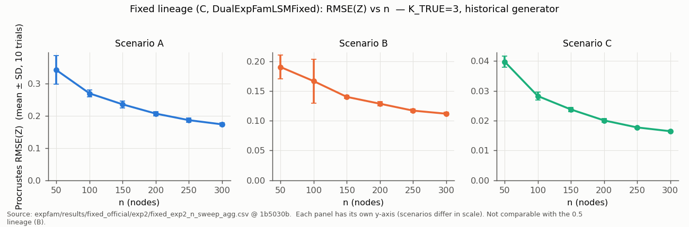
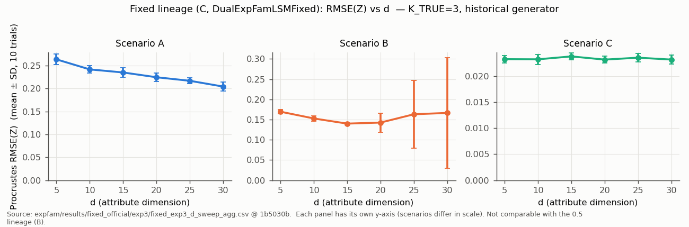

# 03 指数型分布族への拡張（Scenario A/B/C、Exp1–3）

[← README](README.md)

## 1. この実験で知りたかったこと

- $X$・$Y$ の分布を変えても、モデルは潜在構造 $Z$ を推定できるか。
- ノード数 $n$・属性次元 $d$ を増やすと、$Z$ の推定はどう変わるか。
- 潜在次元 $K$ を基準で選べるか（Exp1。詳しくは [07 章](07_latent_dimension_selection.md)）。

## 2. 実験前に分かっていたこと

- 学会予稿は旧 0.5 系列（B）で書かれていた。
- 2026-06 に、0.5 を除いた fixed 系列（C）で同じ Exp1–4 を正式に再実行した。

## 3. 実験条件

| シナリオ | 真の $X$ / $Y$ の分布 |
|---|---|
| A | Poisson-X / Bernoulli-Y |
| B | Gaussian-X / Poisson-Y |
| C | Bernoulli-X / Gaussian-Y |

（FACT：[`exp_run_scenario_A.py`](https://github.com/H-T-0726/expfam-lsm-attributed-relational-data/blob/1b5030b/expfam/src/exp_run_scenario_A.py) L.10 の `run_scenario("poisson", "bernoulli", "A")` ほか B・C も同様。）

| 実験 | 変える条件 | 固定 | 試行 |
|---|---|---|---|
| Exp1 | 候補 $K$（fixed は 1..9） | $n=150$、$K_{TRUE}=3$ | 10 trial / シナリオ |
| Exp2 | $n=50,\dots,300$ | $K_{TRUE}=3$、$d=15$ | 10 trial / $n$ |
| Exp3 | $d=5,\dots,30$ | $K_{TRUE}=3$ | 10 trial / $d$ |

データは historical generator（`expfam/src/data_generator_expfam.py`）で作った。この生成器は $Z$ と Gaussian-X を列ごとに標準化し、$F$ の行を正規化し、Poisson の $\eta$ を $[-20,10]$ で切る（KI-021）。**canonical モデルからそのまま生成したデータではない。**

## 4. 比較した方法

各シナリオで、正しい分布を指定したモデル。系列 B（予稿）と系列 C（fixed）を**別々に**記録する。

## 5. 数式と評価指標

- Procrustes RMSE(Z)：$\min_{R^\top R=I}\lVert \hat Z R - Z\rVert_F/\sqrt{nK}$ の型の誤差（回転の不定性を除く）。
- 相対減少率：$(\mathrm{RMSE}_{n=50}-\mathrm{RMSE}_{n=300})/\mathrm{RMSE}_{n=50}$。

## 6. 結果の表

**fixed 系列（C）**

| 量 | A | B | C | 確認 |
|---|---:|---:|---:|---|
| RMSE(Z) 相対減少（$n=50\to300$） | 49.28% | 41.24% | 58.65% | VERIFIED（B-02） |
| RMSE(Z) $n=50$ → $n=300$ | 0.3417 → 0.1733 | 0.1902 → 0.1118 | 0.0398 → 0.0165 | 一次 CSV |
| $d$ を増やしたとき | 単調減少 0.2639 → 0.2046 | 平均は $d=15$ で最小 0.1401、その後増加。中央値は単調減少（0.1701 → 0.1202）。平均の増加は外れ trial による | 平坦 0.0231〜0.0238 | VERIFIED（B-03） |
| Exp1：C_Q が $K=3$ を選んだ trial | — | — | — | 30/30（3 シナリオ合計、B-01） |

**旧 0.5 系列（B、学会予稿）— 上の表と並べて読まない**

| 量 | A | B | C | 確認 |
|---|---:|---:|---:|---|
| RMSE(Z) 相対減少（$n=50\to300$） | 48.8% | 31.0% | 62.0% | VERIFIED（B-05） |

## 7. 結果の図

図は fixed 系列（C）だけ。旧 0.5 系列は同じ図に入れていない。

## 8. その結果から分かること

- OBSERVED：fixed 系列の明示した人工設定で、3 シナリオとも $n$ を増やすと RMSE(Z) が下がった。
- OBSERVED：$d$ の効果はシナリオで違った。A では改善、C では変わらなかった。B は平均では $d=15$ を過ぎると増えたが、中央値は $d$ とともに単調に減った（0.1403→0.1202）。平均の増加は少数 trial の外れ値による（$d=30$ の SD 0.136、最大 0.554）。
- OBSERVED：$n=150$、$K_{TRUE}=3$ の強信号の条件では、C_Q が 30/30 trial で $K=3$ を選んだ。

## 9. 分からないこと

- 一致性（$n\to\infty$ で真の $Z$ に近づくこと）は示していない。
- canonical モデルから生成したデータでも同じになるか（historical generator のみ）。
- B で $d$ を増やすと平均だけが増える（中央値は減る）原因となった外れ trial が何によるか（未調査）。
- 旧 0.5 系列と fixed 系列の差が「0.5 の有無」によるものか。**条件対応表が存在しない**（RESEARCH_MASTER §15）。

## 10. 公平性・科学的妥当性

- 同じ系列・同じ生成設定の中の $n$・$d$ の比較：**B（限定付き）**。$n$ ごとに別のデータを使う。
- 旧 0.5 と fixed の数値を並べて差を読む：**D（比較してはならない）**（[FC-02](data/comparison_fairness_matrix.csv)）。
- fixed 系列にも $\eta$ の clip と曲率の下限が残る（legacy numerics）。

## 11. 関連する他の実験

- 分布の誤指定（Exp4）：[04 章](04_distribution_misspecification.md)
- $K$ の選択（Exp1 を含む）：[07 章](07_latent_dimension_selection.md)
- canonical clean generator での $n$ 依存（$K$ 選択）：[07 章](07_latent_dimension_selection.md)

## 12. 一次データとリンク

- [`expfam/results/fixed_official/exp2/`](https://github.com/H-T-0726/expfam-lsm-attributed-relational-data/tree/1b5030b/expfam/results/fixed_official/exp2)
- [`expfam/results/fixed_official/exp3/fixed_exp3_d_sweep_agg.csv`](https://github.com/H-T-0726/expfam-lsm-attributed-relational-data/blob/1b5030b/expfam/results/fixed_official/exp3/fixed_exp3_d_sweep_agg.csv)
- [`expfam/results/fixed_official/exp1_k9/fixed_exp1_bic_k1to9_bestk_by_trial.csv`](https://github.com/H-T-0726/expfam-lsm-attributed-relational-data/blob/1b5030b/expfam/results/fixed_official/exp1_k9/fixed_exp1_bic_k1to9_bestk_by_trial.csv)
- 旧 0.5：[`expfam/results/exp_scenario_A_exp2_n.csv`](https://github.com/H-T-0726/expfam-lsm-attributed-relational-data/blob/1b5030b/expfam/results/exp_scenario_A_exp2_n.csv) ほか B・C
- 予稿：[`conference_submission_final_draft.md`](https://github.com/H-T-0726/expfam-lsm-attributed-relational-data/blob/1b5030b/conference_submission_final_draft.md)（変更しない）
