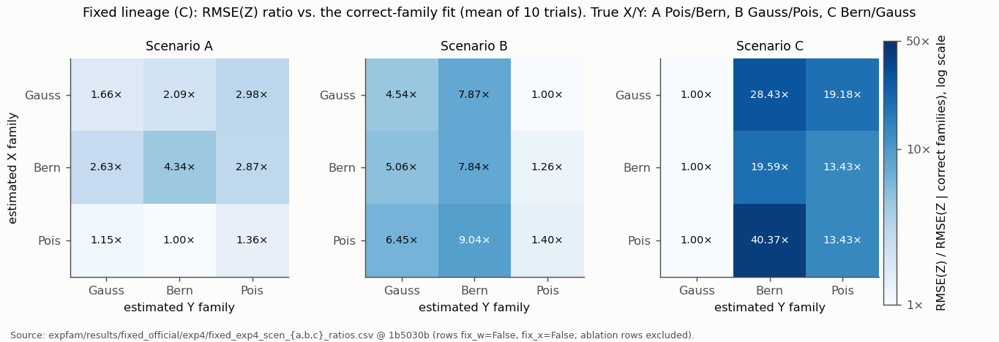
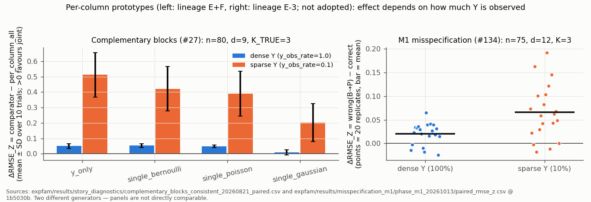

# 04 分布の誤指定

[← README](README.md)

## 1. この実験で知りたかったこと

- データの本当の分布と違う分布を指定して推定すると、潜在構造 $Z$ の推定はどれだけ悪くなるか。
- その悪影響は、関係データ $Y$ がどれだけ観測されているかで変わるか。

## 2. 実験前に分かっていたこと

- 学会予稿（旧 0.5 系列）で、誤指定による RMSE(Z) の悪化（最大 41.45 倍など）が報告されていた。
- 倍率 23.6× / 41.45× / 38.97× は、それぞれ**別の系列・別の条件**の値である（KI-003）。

## 3. 実験条件

| 実験 | 系列 | 誤指定の範囲 | データ | 試行 |
|---|---|---|---|---|
| fixed Exp4 | C（正式モデル、全列共通 family） | $X$・$Y$ の推定 family を 3×3 で変える | historical generator、Scen.A/B/C | 10 trial / セル |
| 予稿 Exp4 | B（0.5） | 同上 | 同上 | 10 trial / セル |
| M1（#134） | E-3（**列ごとの family**） | 真の Bernoulli 6 列を Poisson と誤指定（support-compatible） | Phase 9K と同じ 20 データ（G3/B6/P3）、$K=3$ 固定 | 20 replicate × dense/sparse |
| E1（#141） | E-3 | M1 と同じ。Part B は別 seed | 同上 | 160 fit |
| MX2（PR #168、未 merge） | E-3 | B6→P6、B6→G6、全 Gaussian など × 列数 × Y 観測率 | M1 と同じデータ | 2 seed 系列 |

M1 の dense は学習 Y = pool の 100%、sparse は 10%（どちらも test 10% は固定）。

## 4. 比較した方法

同じデータで、**正しい family を指定した fit** と **誤った family を指定した fit** を対にして比べる。

## 5. 数式と評価指標

- 倍率：$\overline{\mathrm{RMSE}}(Z\mid\text{誤})\ /\ \overline{\mathrm{RMSE}}(Z\mid\text{正})$（10 trial の平均の比）。
- 対差：$\Delta = \mathrm{RMSE}(Z\mid\text{誤}) - \mathrm{RMSE}(Z\mid\text{正})$（replicate ごと、正の値は誤指定で悪化）。
- Bernoulli と Poisson は $\{0,1\}$ の値の上でどちらも定義できる（support-compatible）ので、M1 の誤指定は「あり得る間違い」を想定している。

## 6. 結果の表

**fixed Exp4（系列 C、正式モデル）**

| シナリオ（真の X/Y） | 最大倍率（ablation を除く） | そのセル | 確認 |
|---|---:|---|---|
| A（Pois/Bern） | 4.34× | 推定 Bern/Bern | VERIFIED（B-04-A） |
| B（Gauss/Pois） | 9.04× | 推定 Pois/Bern | VERIFIED（B-04-B） |
| C（Bern/Gauss） | 40.37× | 推定 Pois/Bern | VERIFIED（B-04-C） |
| C（ablation 行を含む最大） | 46.86× | — | VERIFIED（B-04-Call） |

**予稿 Exp4（系列 B、0.5 あり）— 上の表と並べて読まない**：最大 A 3.41×、B 7.35×、C 41.45×（XGauss/YPois）。VERIFIED（B-06）。

**M1・E1・MX2（系列 E-3、拡張モデル）**

| 量 | dense-Y | sparse-Y | 確認 |
|---|---:|---:|---|
| M1：Δ 平均（悪化した replicate 数） | +0.0200（15/20） | +0.0662（17/20） | VERIFIED（D-03） |
| E1 Part B（別 seed）joint mode | — | +0.0871（20/20） | VERIFIED（D-04） |
| E1 Part B last | +0.0021（9/20） | — | VERIFIED（D-05） |
| MX2：B6→P6 の Δ 平均（全 seed 系列） | +0.012（Y 100%） | +0.082（Y 10%） | VERIFIED（D-06） |

## 7. 結果の図

（右パネルが M1。左パネルは [05 章](05_per_column_mixed_families.md) の complementary blocks。2 つは生成器が違うので、パネル間で比較しない。）

## 8. その結果から分かること

- OBSERVED：正式モデル（fixed 系列）で、誤指定は RMSE(Z) を悪化させた。最大値は $X$・$Y$ の両方を誤ったセルだった。
- OBSERVED：Scen.C（真の Y = Gaussian）では、$Y$ を正しく指定すれば $X$ を誤っても倍率は 1.00 だった。$Y$ を誤ると 13〜40 倍になった。
- OBSERVED：拡張モデルの M1 では、Bernoulli→Poisson の悪影響は Y が少ない（sparse）ほうが大きかった。sparse の向きは別 seed（E1）でも再現した。
- OBSERVED：ただし MX2 では、交互作用の向きは誤指定の種類で逆になった（B6→G6 や全 Gaussian では Y が多いほうが悪化が大きいと報告。本監査では B6→P6 だけ再計算した）。

## 9. 分からないこと

- **正式モデル（全列共通 family）で、Y の観測量と誤指定の交互作用を調べた実験は存在しない**（[claim matrix MS-3](https://github.com/H-T-0726/expfam-lsm-attributed-relational-data/blob/8a66894/reports/thesis_adoption/claim_adoption_matrix.md)）。
  - **追補（2026-11-27）**：全列共通の family を使う構造で、この問いを調べた Experiment A を行った（系列 E-scalar、prototype。fixed 系列（C）ではないので、上の文の「正式モデル」の空白はまだ埋まっていない）。Bernoulli→Poisson で dense +0.012 → sparse +0.223（交互作用 +0.211、20/20）と、M1 と同じ向きだった。ただし sparse では正指定でも Z の回復は弱く（RMSE_Z ≈ 1.02）、Y の予測は指標によって良い側が違った（AUC・AP は正指定、Z_last 予測の対数スコアは誤指定）。[13 章 §2](13_two_gaps_followup_20261127.md#2-experiment-ay-の観測量と-x-の分布誤指定)
- 倍率は平均の比で、信頼区間は計算されていない。
- dense-Y の M1 の結果は、E1 の last 推定では再現しなかった（+0.0021、9/20）。
- 「Y が少ないほど誤指定の悪影響が大きい」は一般法則ではない（MX2）。

## 10. 公平性・科学的妥当性

| 比較 | 評価 | 理由 |
|---|---|---|
| fixed Exp4 の正指定 vs 誤指定 | **A** | 同一データ・同一 trial で family だけ変えた（[FC-03](data/comparison_fairness_matrix.csv)） |
| M1 の dense vs sparse | **A** | 同一データ・同一 test で学習 Y の量だけ変えた（FC-06） |
| M1 と E1 | **B** | 同じデータ・別 seed（FC-07） |
| MX2 の誤指定の種類間 | **B** | 列数・family が同時に違う。重複実行事故があり最初の記録だけ採用（FC-08） |
| 23.6× / 41.45× / 38.97× / 40.37× を並べる | **D** | 系列・条件・集計が違う（FC-04） |

## 11. 関連する他の実験

- 自動選択で誤指定を避けられるか：[06 章](06_family_selection.md)（AF1 は M1 と同じデータ）
- MovieLens の raw-count Poisson の悪化：[08 章](08_real_data_experiments.md)
- 過分散 Y を Poisson で推定した人工実験（NB-Y）：registry の過分散節（本監査では未再計算）
- 全列共通 family での Y の量 × 誤指定（Experiment A、2026-11-27 追補）：[13 章](13_two_gaps_followup_20261127.md)。A と M1・MX2 の比較は C、A と fixed Exp4 の数値比較は D（FC-TG-03・04）

## 12. 一次データとリンク

- [`expfam/results/fixed_official/exp4/`](https://github.com/H-T-0726/expfam-lsm-attributed-relational-data/tree/1b5030b/expfam/results/fixed_official/exp4)（main）
- [`expfam/results/mismatch_audit/mismatch_audit_summary.csv`](https://github.com/H-T-0726/expfam-lsm-attributed-relational-data/blob/1b5030b/expfam/results/mismatch_audit/mismatch_audit_summary.csv)（予稿の倍率の条件特定）
- [`expfam/results/misspecification_m1/phase_m1_20261013/`](https://github.com/H-T-0726/expfam-lsm-attributed-relational-data/tree/1b5030b/expfam/results/misspecification_m1/phase_m1_20261013)（main）
- [`expfam/results/z_point_estimator_e1/e1_20261104/full/`](https://github.com/H-T-0726/expfam-lsm-attributed-relational-data/tree/1b5030b/expfam/results/z_point_estimator_e1/e1_20261104/full)（main）
- [`expfam/results/misspecification_extended/phase_20261110/`](https://github.com/H-T-0726/expfam-lsm-attributed-relational-data/tree/856d475/expfam/results/misspecification_extended/phase_20261110)（**未 merge**、PR #168）
- 重複実行事故：[`duplicate_run_incident_20261110.md`](https://github.com/H-T-0726/expfam-lsm-attributed-relational-data/blob/856d475/reports/misspecification_extended/duplicate_run_incident_20261110.md)
