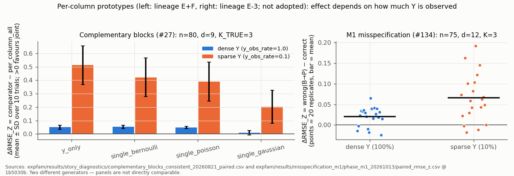

# 05 複数分布 X（per-column）の同時利用

[← README](README.md)

> **注意**：本章の実験はすべて**列ごとに分布を変える拡張モデル**（系列 F・E-3）で、prototype です。正式モデル（全列共通 family）の結果ではなく、本文には採用できません（AGENTS.md §1・§3）。

## 1. この実験で知りたかったこと

- 「属性ごとに別々に分析すればよいのでは？」（ゼミでの問い）に答える。
- Gaussian・Bernoulli・Poisson の属性を**同時に**使うと、1 種類だけ使うより $Z$ の推定は良くなるか。
- それはどんな条件か（Y の観測量、属性が潜在次元のどこを担うか）。

## 2. 実験前に分かっていたこと

- 2026-07 の検証（系列 F、3 seed）では、改善は情報の濃い属性（Gaussian を足すと −22%）だけで、Bernoulli やノイズ属性を足しても効果はなかった（registry）。
- Y が疎な人工条件で効果が見えた（story diagnostics、2026-07-13）。
- 系列 F の legacy numerics には、Poisson の clip の外で目的関数と導関数が一致しない問題があった（PC-001）。そのため 2026-08-21 に objective-consistent 系列（E）を作った。

## 3. 実験条件

| 実験 | 系列 | 条件 | 試行 |
|---|---|---|---|
| per-column デモ・単独 vs 同時・属性 ablation・ノイズ（2026-07） | F | gauss/bern/pois 各 3 列 + Poisson-Y | 3 seed |
| Y sparsity stress（2026-07-13） | F | y_obs_rate ∈ {1.0, 0.5, 0.2, 0.1} | 160 fit |
| complementary blocks（#27、事前登録） | E+F | $n=80$、$d=9$、$K_{TRUE}=3$。Bernoulli→$z_1$、Gaussian→$z_2$、Poisson→$z_3$ を主に担う | 10 trial × y_obs_rate {1.0, 0.1} |
| matched latent-coverage（#31、事前登録） | E+F | 同じ $F$ の行を回して complementary と full_coverage を作る | 10 trial |
| per-column mixed-X の $K$ 選択（2026-09-07、未 merge） | E-3 | homogeneous 3 + mixed 4 config、$K_0=3$、Gaussian-Y | 70 trial |

## 4. 比較した方法

- `per_column_all`：全属性を、それぞれ正しい family で同時に使う。
- `single_*`：1 種類の属性 block だけを使う（使う列数が違う）。
- `y_only`：属性を使わない。
- `all_*`：全列を同じ family で強制する。

## 5. 数式と評価指標

- 対差 $\Delta = \mathrm{RMSE}_Z(\text{comparator}) - \mathrm{RMSE}_Z(\text{per\_column\_all})$。正なら同時利用のほうが良い。
- #31 の交互作用：$I = D_G - D_J$（$D_G$：comparator の regime 間差、$D_J$：joint の regime 間差。恒等式で、数値誤差 0）。

## 6. 結果の表

**complementary blocks（#27）**

| y_obs_rate | comparator | Δ 平均 | 同時利用が良かった trial | 確認 |
|---|---|---:|---:|---|
| 0.1（sparse） | y_only | +0.5122 | 10/10 | VERIFIED |
| 0.1 | single_bernoulli | +0.4218 | 10/10 | VERIFIED |
| 0.1 | single_poisson | +0.3889 | 10/10 | VERIFIED |
| 0.1 | single_gaussian | +0.2030 | 9/10 | VERIFIED |
| 1.0（dense） | single_gaussian | +0.0087 | 9/10 | VERIFIED |

**matched latent-coverage（#31）**：Gaussian comparator で $I=+0.114$（9/10、VERIFIED D-02）。ただし secondary comparator は同じ向きにならず、$D_J=+0.201$ が大きい。

**per-column mixed-X の $K$ 選択**：70/70 trial で $K_0=3$ を選んだ（VERIFIED D-07、Gaussian-Y、未 merge）。

## 7. 結果の図

左パネル：complementary blocks の対差（平均 ± SD、10 trial）。右パネルは [04 章](04_distribution_misspecification.md) の M1。

## 8. その結果から分かること

- OBSERVED：Y が疎（観測率 10%）で、属性 block が補完的に潜在次元を担う人工設定では、同時利用は RMSE_Z を大きく改善した。
- OBSERVED：Y が密（観測率 100%）では、最良の単独 block（Gaussian）との差はほぼ消えた（+0.009、9/10）。属性を使わない y_only との比較では +0.051（10/10）、single_bernoulli 比 +0.053（10/10）、single_poisson 比 +0.049（10/10）で、小さいが一貫して改善した。**比較相手によって結論が変わるので、「dense-Y では効果がない」とは書かない。**
- INTERPRETATION：同時利用の利得は、Y の情報が少なく、属性が互いに違う方向を担うときに出やすい。
- **悪化・差なしの結果**：2026-07 の検証では、Bernoulli 属性・ノイズ属性の追加は効果がなく、ノイズ追加の悪化は seed 依存だった（+13%）。`single_vs_joint` では符号が逆（−0.0004）の比較もあった（RESEARCH_MASTER §14）。

## 9. 分からないこと

- 改善の機構（latent coverage）は確立していない（HYPOTHESIS）。
- 実データでの有効性（MovieLens では小さい。[08 章](08_real_data_experiments.md)）。
- Gaussian 列の情報量が大きいことと、「分布を混ぜること」の効果は分けられていない。**Gaussian 列の情報量の大きさを、混合分布そのものの優位性と読まない。**

## 10. 公平性・科学的妥当性

- per_column_all vs single block：**B**。同じデータだが、比較対象が使う列数が違う（[FC-05](data/comparison_fairness_matrix.csv)）。情報量をそろえた比較ではない。
- dense vs sparse：**A**（同じデータで Y の量だけ変えた）。ただし sparse と dense の違いは、観測量のほかに MC・初期化の経路も変える。
- 2 設定の人工データだけで、一般化はできない。

## 11. 関連する他の実験

- 混合分布 X での高次元 $K$ 選択（G5/B5/P5、K-exp2 追加 C）：[07 章](07_latent_dimension_selection.md)
- MovieLens の mixed-X：[08 章](08_real_data_experiments.md)

## 12. 一次データとリンク

- [`complementary_blocks_consistent_20260821_paired.csv`](https://github.com/H-T-0726/expfam-lsm-attributed-relational-data/blob/1b5030b/expfam/results/story_diagnostics/complementary_blocks_consistent_20260821_paired.csv)（main）
- [`matched_latent_coverage_ablation_20260821_interaction.csv`](https://github.com/H-T-0726/expfam-lsm-attributed-relational-data/blob/1b5030b/expfam/results/story_diagnostics/matched_latent_coverage_ablation_20260821_interaction.csv)（main）
- [`expfam/results/per_column_family/`](https://github.com/H-T-0726/expfam-lsm-attributed-relational-data/tree/1b5030b/expfam/results/per_column_family)（main、系列 F）
- [`percolumn_mixed_x_k_selection_20260907/`](https://github.com/H-T-0726/expfam-lsm-attributed-relational-data/tree/d610a8d/expfam/results/percolumn_mixed_x_k_selection_20260907)（**未 merge**）
- 報告：[`complementary_blocks_consistent_report_20260821.md`](https://github.com/H-T-0726/expfam-lsm-attributed-relational-data/blob/1b5030b/reports/story_diagnostics/complementary_blocks_consistent_report_20260821.md)、[`matched_latent_coverage_ablation_report_20260821.md`](https://github.com/H-T-0726/expfam-lsm-attributed-relational-data/blob/1b5030b/reports/story_diagnostics/matched_latent_coverage_ablation_report_20260821.md)
