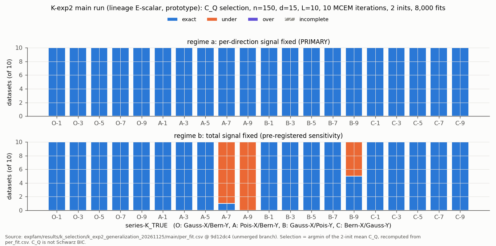
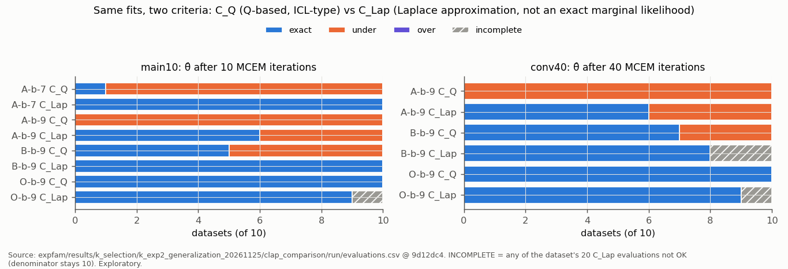
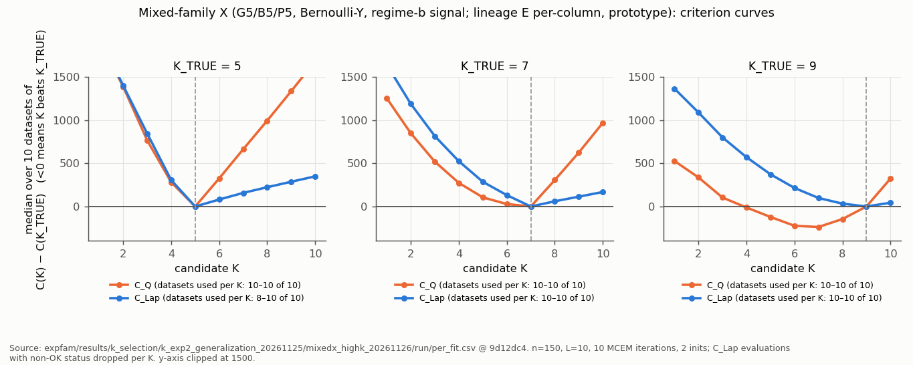
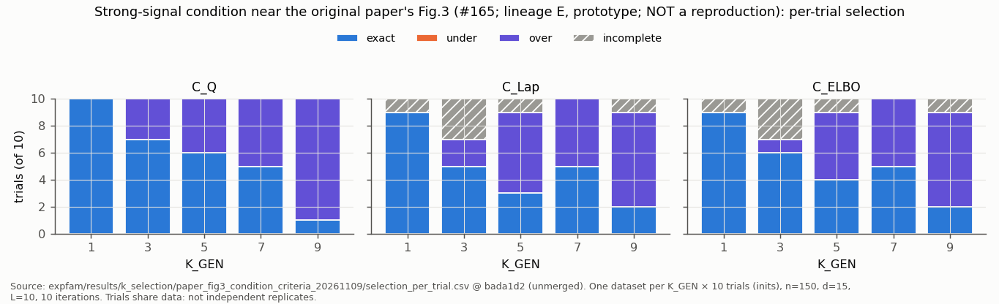
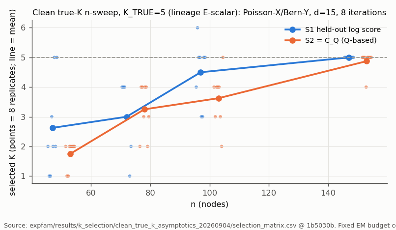

# 07 潜在次元 K の選択

[← README](README.md)

> この章の実験は、fixed Exp1（系列 C）を除き、ほぼすべて系列 E（prototype）です。#155–#165 と K-exp2 は **`main` に未統合**です。

## 1. この実験で知りたかったこと

- 潜在次元 $K$ を、データから正しく選べるか。
- どの基準を使うと、どの条件で過小・過大に選ぶか。
- 原論文 Exp.2（Fig.3）では $K=1\sim9$ が選べていたのに、本研究ではなぜ過小選択が起きたのか。

## 2. 実験前に分かっていたこと

- 原論文 Eq.(26) の $\ln L$ は、$Z$ に条件付けた尤度（Eq.(16)）で、$p(Z)$ を含まず $Z$ を積分していない。どの $Z$ で評価したかは本文から決まらない（#35、#163、FACT）。
- 本研究の C_Q は Schwarz BIC ではない（KI-010）。
- $K_{TRUE}$（生成に使った次元）は、母集団の最小の潜在次元 $K^\ast$ と同じとは限らない（RESEARCH_MASTER §17.2）。

## 3. 実験条件（主なもの）

| 実験 | 系列 | 主な条件 | 規模 |
|---|---|---|---|
| fixed Exp1 | C | $n=150$、$K_{TRUE}=3$、候補 1..9 | 30 trial |
| Phase 7e / 8b | E-scalar | held-out 予測、Poisson-X / Bernoulli-Y、$n=75$ | 42 + 336 fit |
| clean n-sweep | E-scalar | canonical clean generator、$K_{TRUE}\in\{1,3,5\}$、$n=50..150$ | 896 fit |
| Phase 9E・9K ほか | E-3 | $n=75$、$d=12$、G3/B6/P3、$K_{TRUE}=3$ | 各 20 データ |
| d-sweep、R1/R2、EM 収束 | E-scalar | $n=75$、$K_{GEN}=5$ | 224 / 336+ / 448 fit |
| historical P/B | historical（0.5） | $K_{TRUE}=5$、$n=50..150$ | 200 fit |
| Gaussian-Y、per-column mixed-X | E | Gaussian-Y、$K_0\in\{1,3,5\}$ | 各 70 trial |
| #155–#162 | E（と OLD） | 因果分析・MCEM 安定性・公平比較 | 計 1,000 fit 超 |
| #164 | E-scalar | $K_{GEN}=5$、4 基準を同じ状態で比較 | 448 新規 fit |
| #165 | E-scalar | 原論文 Fig.3 に近い強信号 | 500 fit |
| **K-exp2 本実験** | E-scalar | 4 系列 × regime a/b × $K_{TRUE}\in\{1,3,5,7,9\}$、$n=150$、$d=15$ | 8,000 fit |
| K-exp2 収束感度 | E-scalar | 3 セルを 40 反復まで | 600 fit |
| K-exp2 C_Q vs C_Lap | E-scalar | 同じ θ̂ の再評価 | 6,600 評価 |
| K-exp2 追加 A・B | E-scalar | C_Lap の開始点・反復上限 | 1,400 + 57 評価 |
| K-exp2 追加 C | E-3 | 混合 X（G5/B5/P5）、$K_{TRUE}$ 5/7/9 | 600 fit + pilot 80 |

## 4. 比較した方法（基準）

| 基準 | 何を計算しているか |
|---|---|
| **C_Q** | $-2Q_{\rm strict}+p\ln n$。$Q_{\rm strict}$ は完全データ対数尤度の E-step 事後期待値の MC 近似（ICL 型） |
| **C_Lap** | $\hat Z$（同時 mode）でのラプラス近似による周辺尤度 + $d_K\ln n$（厳密な周辺尤度ではない） |
| C_ELBO | 既存の変分下界による基準（#164） |
| 条件付き尤度型 | $Z$ を固定した $-2\ln p(X,Y\mid\hat Z,\theta)$ + 罰則（原論文 Eq.(26) に着想、原論文の BIC そのものではない） |
| held-out 予測 | 学習から外したペアの Bernoulli 対数スコア（S1） |

## 5. 数式と評価指標

$$
C_Q = -2\,Q_{\rm strict} + p\ln n,\qquad p = Kd-\tfrac{K(K-1)}{2}+[\text{Gaussian-X の分散パラメータ数}]+[\text{Gaussian-Y の }\sigma_Y]
$$

（$w_0, w$ は数えない。NOLTA 2024 の慣行に従う実装。`utils_expfam.py`・`eval_utils.py`。）

$$
C_{\rm Lap} = -2\ln p(X,Y\mid\hat Z,\hat\theta) + \lVert\hat Z\rVert^2 + \ln\lvert H\rvert + d_K\ln n
$$

（$H$ は $\hat Z$ での負の対数事後の Hessian。$\ln p(\hat Z)$ の $2\pi$ の項とラプラス近似の $2\pi$ の項は打ち消し合う。）

**C_Q に含まれる $K$ だけで決まる項**（DERIVED、K-exp2 claim_ledger 命題 D、#159）：
`scale_Z` で $Z$ の標本を平方平均 1 にそろえるため、$\ln p(Z)$ の項はデータによらず
$-2\,\mathbb E\ln p(Z) = nK(1+\ln 2\pi)$
になる。$n=150$ では 1 次元あたり 425.68、$n=75$ では 212.8。

**理想化した関係**（DERIVED、#163。厳密な事後分布 $\pi$ で評価した場合）：

$$
C_Q^\ast \approx C_{\rm marg} + 2H(\pi),\qquad (C_Q - P_Z)^\ast \approx C_{\rm marg} - 2\,\mathrm{KL}(\pi\,\Vert\,p_Z)
$$

C_Q は、事後分布が広い（データが $Z$ をよく決めない）とき、大きい $K$ に厳しくなる。
ガウス近似では、新しい次元の事後精度（ノードあたり）が $2\pi e\approx17.1$ より小さいと、C_Q は周辺尤度型より厳しい。

評価：$\hat K=K_{TRUE}$ を正解、$\hat K<K_{TRUE}$ を過小、$\hat K>K_{TRUE}$ を過大。C_Lap では、データの 20 評価のうち 1 つでも非 OK なら INCOMPLETE とし、**分母は 10 のまま**にする。

## 6. 結果の表

**強い信号の条件**（系列・生成器が実験ごとに違うので、行の間で数値を比べない。fixed 系列（C、historical generator）の Exp1 30/30 は [03 章](03_exponential_family_extension.md) に記載）

| 実験（系列・生成器） | 結果 | 確認 |
|---|---|---|
| K-exp2 regime a（E-scalar、canonical-clean-v1、方向ごとの信号を固定） | C_Q が 200/200 データで $K_{TRUE}$（4 系列 × $K_{TRUE}\in\{1,3,5,7,9\}$。$K_{TRUE}=3$ のデータは regime a/b で共有） | VERIFIED（F-12） |
| #165（E-scalar、原論文本文どおりの生成、1 データ × 10 試行） | C_Q 29/50（$K_{GEN}$=1,3,5,7,9 で 10/7/6/5/1）、**過小 0**、誤りは過大。C_Lap 24/50（過大 20、評価不能 6）、C_ELBO 26/50（評価不能 6）。評価不能の内訳は $K_{GEN}$=1:1、3:3、5:1、9:1 | VERIFIED（F-07〜F-09b） |
| canonical Gaussian-Y（E-scalar、未 merge） | 70/70（Gaussian-Y） | VERIFIED（F-26） |
| per-column mixed-X の K 選択（E-3、列ごとの family、未 merge） | 70/70（Gaussian-Y） | VERIFIED（D-07） |

- K-exp2 の過大選択 0 は 400 データでの値である。$K_{TRUE}=3$ のデータは regime a/b で共有しているので、異なる条件としては 360（claim_ledger T3）。
- **#165 の評価不能 6 試行**（FACT、[`incomplete_and_invalid_runs.csv`](https://github.com/H-T-0726/expfam-lsm-attributed-relational-data/blob/bada1d2/expfam/results/k_selection/paper_fig3_condition_criteria_20261109/incomplete_and_invalid_runs.csv)）：MCEM の fit はすべて OK。C_Lap の同時 mode の評価が 8 状態で失敗した（NOT_STATIONARY 7、HESSIAN_NOT_PD 1。8 状態中 7 は $k>K_{GEN}$）。C_ELBO は同じ $q_{\rm Lap}$ を使うので、同じ試行で評価できない。その試行では候補 $K$ がそろわないため選択をせず INCOMPLETE とした。本結果集では**全 50 試行を分母**にする（24/50、26/50）。#165 の報告書の 24/44・26/44 は評価できた試行だけを分母にした値で、全体の正解率ではない。

**弱い信号・高い $K_{TRUE}$ の条件**

| 実験 | C_Q | C_Lap | 確認 |
|---|---|---|---|
| Phase 9K（$n=75$、$K_{TRUE}=3$） | 14/20 | 19/20 | VERIFIED（F-05） |
| #164 確認（$K_{GEN}=5$、正解/過小/過大） | 23/9/0 | 27/3/0（C_ELBO 25/5/0） | VERIFIED（F-10） |
| d-sweep（$d$=15/30/60、各 8） | 0/3/5 | — | VERIFIED（F-06） |
| K-exp2 A-b-7 | 1/10 | 10/10 | VERIFIED（F-13、F-20） |
| K-exp2 A-b-9（10 反復 / 40 反復） | 0/10 / 0/10 | 6/10 / 6/10 | VERIFIED（F-13、F-16、F-19） |
| K-exp2 B-b-9（10 / 20 / 40 反復） | 5/10 → 8/10 → 7/10 | 10/10（10 反復）、8/10・INCOMPLETE 2（40 反復） | VERIFIED（F-16、F-19b） |
| K-exp2 混合 X $K_{TRUE}=5$ | 10/10 | 6/10（INCOMPLETE 4） | VERIFIED（F-23、F-24） |
| 同 $K_{TRUE}=7$ | 6/10 | 10/10 | VERIFIED |
| 同 $K_{TRUE}=9$ | 0/10 | 9/10 | VERIFIED |

**K-exp2 の全体（main10、series O/A/B の 300 データ。series C は C_Lap の対象外）**：C_Q は正解 276・過小 24・過大 0。C_Lap は正解 249・過小 4・過大 0・INCOMPLETE 47（RECOMPUTED F-18c）。ただしこの 300 には、regime a と b で同一の $K_{TRUE}=3$ のデータ（30）が二重に入っている。重複を除いた 270 データでは C_Q 正解 246・過小 24・過大 0、C_Lap 正解 227・過小 4・過大 0・INCOMPLETE 39（VERIFIED F-18d。一次報告の「39/270」と一致。a・b の $K_{TRUE}=3$ の選択はすべて一致）。上の表の弱信号セルは、C_Q が失敗したセルを選んで示している。

**$n$ を増やしたとき**（2 つは系列・生成器が違うので、互いに比較しない）：clean n-sweep の $K_{TRUE}=5$ で、選択 $K$ の平均は S1（held-out）2.62→5.00、S2（C_Q）1.75→4.88（$n=50\to150$、VERIFIED F-03）。historical P/B では正解が $n$=50/75/100/150 で 1/5、4/5、5/5、5/5（VERIFIED F-27）。

**C_Lap の数値的な失敗**：K-exp2 main10 で INCOMPLETE 47/300 データ（VERIFIED F-18。重複を除くと 39/270、F-18d）。追加検証 B で、NOT_STATIONARY 52 件のうち max_iter=400 で収束したのは 6 件だけだった（報告書の値）。

## 7. 結果の図

（fig08 の C_Lap は、各 $K$ で非 OK の評価を除いて中央値をとっている。$K_{TRUE}=5$ では 4/10 データが INCOMPLETE なので、曲線は全データを代表しない。）

## 8. その結果から分かること

- OBSERVED：**成否と誤りの向きは条件で変わった。** K-exp2 regime a（canonical-clean-v1、方向ごとの信号を固定）では C_Q は 200/200 正解で過大 0 だった。原論文本文どおりに生成した強信号（#165、1 データ × 10 試行の試行ごとの集計）では C_Q・C_Lap・C_ELBO は過小選択せず、誤りは $K_{GEN}+1$ への過大選択だった。強信号の条件で C_Q の過大選択が観測されたのは #165 だけで（fixed Exp1 と K-exp2 regime a は過大 0）、これらは生成器・系列・集計規則が違う別の実験である。全体の信号を固定して $K_{TRUE}$ を大きくした条件（regime b）では、C_Q は過小選択した。
- OBSERVED：同じ推定結果の上で、C_Q は C_Lap と同じか小さい $K$ を選んだ（#164：27/27、30/30）。弱信号では C_Lap のほうが $K_{TRUE}$ を多く選んだ。
- DERIVED + OBSERVED：その差は、理想化した恒等式で事後エントロピーの項に対応し、数値でも向きが一致した（#164：符号の一致 60/61、58/62）。
- OBSERVED：C_Q の過小選択は、MCEM の反復を増やしても A-b-9 では変わらなかった（0/0/0）。B-b-9 では一部が回復した（5→8→7）。
- OBSERVED：原論文型の条件付き尤度の基準は、本研究のすべての条件で過大選択した（#159、#164、#165）。
- OBSERVED：混合分布 X（G5/B5/P5）でも、単一分布 X と同じ向き（$K_{TRUE}$ が高いと C_Q が過小、C_Lap は $K_{TRUE}$ 付近）が見られた。

## 9. 分からないこと

- どの基準についても一致性は証明されていない。
- C_Lap は近似で、誤差の大きさ・向き・$K$ 依存性は測っていない。**C_Lap が正しい基準とは言えない。**
- **C_Lap が過大選択しないとは言えない**：#159 と K-exp2 の完了データでは過大 0 だったが、#165 では 50 試行中 20 が過大だった（評価不能 6）。K-exp2 の INCOMPLETE は余分な次元に偏る（矛盾する結果として記録）。
- 原論文 Fig.3 で正しく選べた理由（手順が特定できない）。
- Bernoulli-Y での識別可能性（U2）。
- regime a/b の違いのうち、どの成分（1 方向あたりの信号、全体の信号、X 側・Y 側の配分、$w_0$）が効いたか。

## 10. 公平性・科学的妥当性

| 比較 | 評価 | 理由 |
|---|---|---|
| 同じ fit での C_Q vs C_Lap | **B** | 同じ θ̂・同じデータだが、θ̂ は C_Lap の停留点ではなく、INCOMPLETE は C_Lap 側だけに偏って出る。多くは事後・探索（[FC-14](data/comparison_fairness_matrix.csv)） |
| K-exp2 regime a vs b | **A** | $Z$・Q を共有した対応比較（FC-15）。原因の特定は C |
| K-exp2 の系列 O/A/B/C 間 | **C** | family・ノイズ・$w$ 規則が同時に違う（FC-16） |
| 単一分布 X vs 混合分布 X | **C** | 列構成・信号量・実装クラスが違う（FC-17） |
| 原論文 Fig.3 と本研究 | **D** | 原論文の手順が特定できない（FC-18） |
| 歴史的な成功 vs canonical の失敗 | **C** | 6 要因が同時に違う（FC-19） |
| 強信号 vs 弱信号 | **C** | 信号・$n$・集計規則が違う（FC-20） |
| C_Lap の INCOMPLETE を除いた正解率 | **D** | 選択バイアスが入る（FC-31） |
| #165 の 10 試行を独立な replicate と数える | **D** | データを共有している（FC-32） |

## 11. 関連する他の実験

- 識別可能性の理論（P1〜P8）：[11 章](11_limitations_and_open_questions.md)
- MCEM の MC 雑音（#157）：変化の約 2/3 が E-step の MC 雑音で、8〜64 反復で系統的な移動は検出されなかった（報告書の値）。
- held-out 予測による選択（Phase 7e：3 replicate で $K$=3,3,5、Phase 8b：新規グリッドで 18/24、VERIFIED F-01・F-02）。

## 12. 一次データとリンク

- main：[`fixed_official/exp1_k9/`](https://github.com/H-T-0726/expfam-lsm-attributed-relational-data/tree/1b5030b/expfam/results/fixed_official/exp1_k9)、[`clean_true_k_asymptotics_20260904/`](https://github.com/H-T-0726/expfam-lsm-attributed-relational-data/tree/1b5030b/expfam/results/k_selection/clean_true_k_asymptotics_20260904)、[`lap_vs_cq_20/phase9k_20260928/`](https://github.com/H-T-0726/expfam-lsm-attributed-relational-data/tree/1b5030b/expfam/results/lap_vs_cq_20/phase9k_20260928)、[`dsweep_k_selection_20261105/`](https://github.com/H-T-0726/expfam-lsm-attributed-relational-data/tree/1b5030b/expfam/results/k_selection/dsweep_k_selection_20261105)
- #155–#165（未 merge）：[`expfam/results/k_selection/`](https://github.com/H-T-0726/expfam-lsm-attributed-relational-data/tree/bada1d2/expfam/results/k_selection)、理論：[`bic_theory_candidate_assessment_20261108/`](https://github.com/H-T-0726/expfam-lsm-attributed-relational-data/tree/bada1d2/reports/k_selection_theory/bic_theory_candidate_assessment_20261108)
- K-exp2（未 merge）：[`k_exp2_generalization_20261125/`](https://github.com/H-T-0726/expfam-lsm-attributed-relational-data/tree/9d12dc4/expfam/results/k_selection/k_exp2_generalization_20261125)、claim ledger：[`claim_ledger.md`](https://github.com/H-T-0726/expfam-lsm-attributed-relational-data/blob/9d12dc4/reports/k_selection_exp2_generalization/claim_ledger.md)
- historical P/B（未 merge）：[`historical_pb_k5_n_sweep_20260906/`](https://github.com/H-T-0726/expfam-lsm-attributed-relational-data/tree/600108d/expfam/results/k_selection/historical_pb_k5_n_sweep_20260906)
- Gaussian-Y（未 merge）：[`canonical_gaussian_y_k_selection_20260907/`](https://github.com/H-T-0726/expfam-lsm-attributed-relational-data/tree/d610a8d/expfam/results/canonical_gaussian_y_k_selection_20260907)
