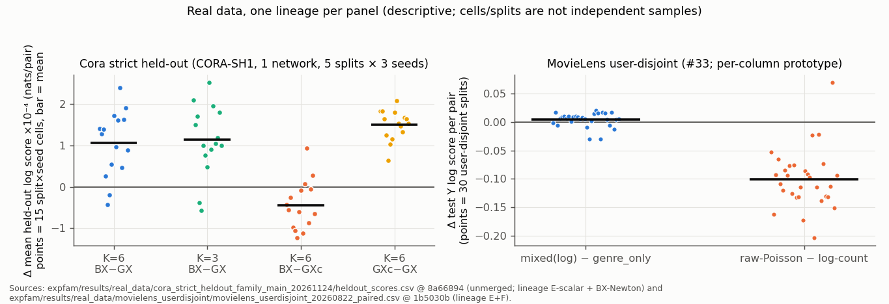

# 08 実データ実験

[← README](README.md)

> 実データでは、**正しい潜在構造 $Z$ も、正しい分布族も分かっていません。** そのため、人工データのように「真値との一致」で評価することはできません。

## 1. この実験で知りたかったこと

- 一般化したモデルは、実データで数値的に安定に動くか。
- 未知のペアの関係を予測できるか（held-out 予測）。
- 属性 $X$ や分布族の選び方で、予測は変わるか。

## 2. 実験前に分かっていたこと

- 人工データでは、Y が疎なときに属性の効果が出やすかった（[05 章](05_per_column_mixed_families.md)）。
- fixed 系列（C）には pair mask がなく、当初は strict held-out 評価ができなかった。

## 3. 実験条件

| データ | 実験 | 系列 | $X$ / $Y$ | 評価 |
|---|---|---|---|---|
| Wine | fixed pilot、clean | C | Gaussian-X / Bernoulli-Y（**Y はクラスラベルから作った**） | in-sample、C_Q、NMI |
| Cora（旧） | balanced_degree subset（$n=280\to700$） | C | Bernoulli-X / Bernoulli-Y | transductive held-out（AUC・AP、負例 1:5） |
| Cora（新） | CORA-SH1（2026-11-24、未 merge） | E-scalar + BX-Newton | Bernoulli-X または Gaussian-X / Bernoulli-Y | strict dyad held-out（全ペアの 20% を mask）、5 split × 3 seed |
| MovieLens | in-sample（2026-06〜07） | C | Bernoulli-X / Poisson-Y | 再構成 Pearson |
| MovieLens | 過分散診断、Poisson/NB strict held-out | C / D | Poisson / NB | var/mean、held-out LL |
| MovieLens | user-disjoint（#33） | E+F | mixed X / Poisson-Y | 30 user-disjoint split、test Y の対数スコア |
| NIPS12 など | — | — | — | **一次記録は見つからない**（先行研究レビューで言及のみ）。存在しないとは断定しない |

## 4. 比較した方法

- Wine：$k=1..9$、ablation（X+Y / X_only / Y_only）。
- 旧 Cora：$k$ 間、random 基準。
- CORA-SH1：BX（Bernoulli-X、raw）、GX（Gaussian-X、raw）、GXc（Gaussian-X、列中心化）、YO（Y のみ）。
- MovieLens #33：mixed_train_log（genre + log 変換した属性）vs genre_only。raw-count Poisson vs log-count。

## 5. 数式と評価指標

- held-out log score：学習から外したペアについての $\frac{1}{|T|}\sum_{(i,j)\in T}\log p(y_{ij}\mid\hat\eta_{ij})$。
- CORA-SH1 の primary は mc_predictive（E-step のサンプルで予測確率を平均）。
- AP は負例のサンプリング比に依存する（旧 Cora は 1:5 で random AP = 0.1667）。

## 6. 結果の表

| データ | 結果 | 確認 |
|---|---|---|
| Wine | C_Q（列名 BIC）平均の最小は $k=3$（6324.77）。ablation では Y が分離の主要因 | VERIFIED（C-01） |
| 旧 Cora | test_AP 0.4319（$k=3$）、0.4631（$k=6$）、random 0.1667。C_Q 最小は $k=1$ | VERIFIED（C-02） |
| MovieLens（in-sample） | 再構成 Pearson ≈ 0.96 | 報告書の値 |
| MovieLens 過分散 | co-rating count の周辺 var/mean = 9.89 | VERIFIED（C-05） |
| MovieLens #33 | mixed − genre_only：平均 +0.004248（23/30 split で正）。std/\|mean\| 2.89 | VERIFIED（C-03） |
| MovieLens #33 | raw-Poisson − log-count：平均 −0.100274（正は 1/30） | VERIFIED（C-04） |
| CORA-SH1 | $K=6$ BX − GX：+1.059×10⁻⁴ nats/pair（13/15）。$K=3$：+1.136×10⁻⁴（13/15） | VERIFIED（C-06） |
| CORA-SH1 | $K=6$ BX − GXc：−4.4×10⁻⁵（3/15 で正）＝中心化すると Gaussian が上回る | VERIFIED（C-06） |

## 7. 結果の図

## 8. その結果から分かること

- OBSERVED：Bernoulli-X / Poisson-Y など、先行研究にない組合せでも数値的に安定に収束した。
- OBSERVED：MovieLens（user-disjoint）では、mixed − genre_only の差は**分割間のばらつきに比べて小さかった**（std/|mean| 2.89）。
- OBSERVED：CORA-SH1 では、BX − GX の差は絶対値が小さい（約 1×10⁻⁴ nats/pair）が、raw 同士では 15 対中 13 で正、split 0・2・3・4 では 3 seed すべてで正だった。ただし 1 ネットワーク・固定予算・EM 未収束で、中心化（GXc）すると逆転した。
- OBSERVED：MovieLens では raw-count の Poisson 属性が log-count より 29/30 split で悪化した（悪化した条件）。
- OBSERVED：CORA-SH1 では、family の差（BX vs GX）は、前処理（列中心化）の有無で逆転した。
- OBSERVED：C_Q は実データで基準ごとに最適 $k$ が割れた（旧 Cora：C_Q は $k=1$、AUC/AP は $k=6$、NMI は $k=3$）。

## 9. 分からないこと

- 実データでの真の $K$・真の分布族（分からないので「正しく選んだ」とは言えない）。
- raw-count Poisson が悪化した原因（切片の欠如、raw scale、Poisson の曲率、X 側の過分散が交絡、KI-018）。
- CORA-SH1 の差が分布族によるのか、切片なし仕様と前処理によるのか。
- Cora subset（$n=280$）の結果が full Cora（$n=2708$）に一般化するか。

## 10. 公平性・科学的妥当性

| 比較 | 評価 | 理由 |
|---|---|---|
| CORA-SH1 の BX vs GX vs GXc | **B** | 同じ split・seed の対比較。統計単位は Cora 1 ネットワーク。family と前処理が交絡（[FC-25](data/comparison_fairness_matrix.csv)） |
| 旧 Cora と CORA-SH1 | **D** | 旧は test 辺を Y_train=0 として学習する transductive 設計で、subset も指標も違う（FC-26） |
| MovieLens in-sample と user-disjoint | **D** | 評価が違い、旧 subset に selection leakage（FC-27） |
| MovieLens mixed vs genre_only | **B** | 30 split は同じ 943 users の再利用で独立ではない（FC-28） |
| Wine の $k=3$ とクラス数 | **C** | Y がラベル由来なので一致は設計に依存（FC-29） |

**canonical docs との不一致（報告のみ、書き換えていない）**：
`RESEARCH_MASTER.md` §8b は旧 Cora について「自然な引用ネットワークでの汎化性能を確認」、`KNOWN_ISSUES.md` は「held-out link prediction で random 基準を上回る」と書いている。
一次コード（`run_fixed_real_cora_heldout_link_prediction.py`）では test 辺を学習時に 0 とし、全グラフの次数で subset を選び、NaN 時に seed を変えて retry していた（11/24 の一次確認）。
数値は正しいが、**strict held-out と読める書き方は避けるべき**である。forward update するかは研究者が判断する。

## 11. 関連する他の実験

- MovieLens の属性診断（count 属性の扱いが悪化要因、2026-07）：[05 章](05_per_column_mixed_families.md)
- 共有 $Z$ の ablation、NB との比較：台帳 C-ML-SHAREDZ、C-OD-STRICT（本監査では未再計算）

## 12. 一次データとリンク

- [`wine_clean/`](https://github.com/H-T-0726/expfam-lsm-attributed-relational-data/tree/1b5030b/expfam/results/real_data/wine_clean)、[`cora_clean/`](https://github.com/H-T-0726/expfam-lsm-attributed-relational-data/tree/1b5030b/expfam/results/real_data/cora_clean)（main）
- [`movielens_userdisjoint/`](https://github.com/H-T-0726/expfam-lsm-attributed-relational-data/tree/1b5030b/expfam/results/real_data/movielens_userdisjoint)、[`overdispersion/`](https://github.com/H-T-0726/expfam-lsm-attributed-relational-data/tree/1b5030b/expfam/results/overdispersion)（main）
- [`cora_strict_heldout_family_main_20261124/`](https://github.com/H-T-0726/expfam-lsm-attributed-relational-data/tree/8a66894/expfam/results/real_data/cora_strict_heldout_family_main_20261124)、[報告](https://github.com/H-T-0726/expfam-lsm-attributed-relational-data/blob/8a66894/reports/real_data/cora_strict_heldout_family_main_report_20261124.md)（**未 merge**）
- [`reports/real_data/movielens_userdisjoint_validation_report_20260822.md`](https://github.com/H-T-0726/expfam-lsm-attributed-relational-data/blob/1b5030b/reports/real_data/movielens_userdisjoint_validation_report_20260822.md)
