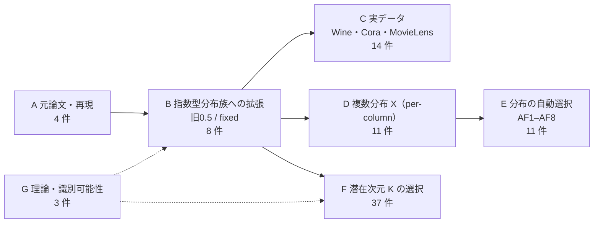

# 研究結果集：属性付き関係データの潜在構造モデルの指数型分布族への一般化

この結果集は、修士研究のこれまでの実験を、一次データに戻って確認し、比較の公平性を監査したうえで、まとめたものです。
**最初に読むページ**です。

> **この結果集の位置づけ**
>
> - 2026-11-27 に作成しました。種類は THEORY / AUDIT で、**新しい実験やモデル fit はしていません**。
> - 既存の結果 CSV・protocol・レポートは一切変更していません。
> - 数値は一次 CSV から独立に再集計しました（[`data/primary_results_index.csv`](data/primary_results_index.csv)）。
> - **修論本文に採用するかどうかは、研究者と指導教員が決めます（Human Gate）。** ここで「言える」「限定付き」と書いているのは推奨区分で、決定ではありません。
> - `main` に統合されていない作業ブランチの結果も含みます。その場合は必ず commit とブランチ名を書いています。**未統合の結果を `main` 採用済みとして読まないでください。**
> - **追補（2026-11-27）**：スナップショットの作成後に行った追加実験 A・B（`1ef9096`）、その原因分析（`2f71e61`）、数理的な最終訂正（`c035df7`）を [13 章](13_two_gaps_followup_20261127.md) にまとめました。下の 88 件・96 項目などの件数はスナップショットの値のままで、追補の分は別の台帳に記録しています（§3b）。

## 1. この研究は何をしているか（専門外の人向け）

たとえば論文の引用ネットワークを考えます。
**関係**（論文 i が論文 j を引用したか）と、**属性**（各論文に含まれる単語）の 2 種類のデータがあります。
このモデルは、各ノード（論文）が見えない位置 $z_i$ を持ち、その位置から関係と属性の両方が生まれると考えます。

| 記号 | 意味 | 例 |
|---|---|---|
| $Y$ | ノード間の**関係**（$n\times n$、$y_{ij}$） | 引用の有無（0/1）、共評価の回数、類似度 |
| $X$ | 各ノードの**属性**（$n\times d$、$x_{il}$） | 単語の有無、評価値、件数 |
| $Z$ | 各ノードの**見えない位置**（$n\times K$、$z_i$）。推定する | 論文の「話題」の座標 |
| $K$ | $Z$ の**次元**（潜在次元） | 話題の軸の数 |
| $F$ | 属性の負荷行列（$d\times K$、$f_l$） | どの軸がどの単語に効くか |

先行研究（Mikawa et al. 2024）は、$X$ を正規分布（Gaussian）、$Y$ を 0/1（Bernoulli）に固定していました。
本研究は、$X$ と $Y$ の分布を **Gaussian / Bernoulli / Poisson から独立に選べる**ように一般化し、その挙動・有効な条件・限界を、人工データと実データで調べています。
一般化が有効であることは前提にしていません。

$$
z_i \sim \mathcal N(0, I_K),\qquad
y_{ij} \sim \mathrm{ExpFam}_Y\!\left(\eta^Y_{ij} = w_0 + w\, z_i^\top z_j\right)\ (i<j),\qquad
x_{il} \sim \mathrm{ExpFam}_X\!\left(\eta^X_{il} = f_l^\top z_i\right)
$$

$w_0, w$ はスカラーです。標準モデルでは $X$ の全列が同じ分布族です（列ごとに分布を変えるモデルは prototype で、本文には採用できません）。

## 2. 実験の全体像

**88 件**の実験・監査を、7 つの研究領域に分けて台帳にしました（[`data/experiment_inventory.csv`](data/experiment_inventory.csv)）。



数え方は「1 つの研究問いと 1 回の実行（またはその監査）」を 1 件とし、`EXPERIMENT_REGISTRY.md`（549 行、表のデータ行 120、うち実験・結果の行は約 90）で複数行に分かれた同じ実験はまとめ、registry にない未統合ブランチの実験を加えました。88 件のうち main にあるのは 53 件、未統合ブランチだけにあるのは 34 件です。詳しい対応は [09 章 §7](09_fairness_and_validity_audit.md#7-結果網羅性) にあります。

**全実験を完全に検証したわけではありません。** 一次 CSV まで再計算したのは 88 件中 33 件で、36 件は報告書の値を引用しています。

台帳の各行は、確認できた程度で次のように分類しています。

| 確認の状態 | 件数 | 意味 |
|---|---:|---|
| CONFIRMED | 33 | 一次結果があり、本監査で主要数値を再計算して一致した |
| PRIMARY_NOT_RECOMPUTED | 36 | 一次結果はあるが、本監査では再計算せず報告書の値を引用した |
| THEORY_AUDIT | 7 | EM fit を伴わない理論・監査 |
| REPORT_ONLY | 4 | レポートだけで、一次結果を確認できない |
| NEEDS_LOCAL_NPZ | 2 | 再評価に git 管理外の NPZ が必要 |
| STOPPED | 2 | 中断・停止規則による停止 |
| OLD_NOT_ADOPTED | 2 | 古い・不採用・AI 生成 |
| PRIMARY_PARTIAL | 1 | 一次結果はあるが条件の一部が不明 |
| DESIGN_ONLY | 1 | 設計・実装だけで本実行していない |

## 3. 最も重要な結果（すべて限定付き）

| # | 結果 | 系列 | 確認 |
|---|---|---|---|
| 1 | fixed 系列の人工データで、$n=50\to300$ で RMSE(Z) が A 49.3%・B 41.2%・C 58.6% 減少した | C（fixed） | [B-02](data/primary_results_index.csv) |
| 2 | fixed 系列で分布を誤指定すると RMSE(Z) が悪化し、最悪は A 4.34 倍・B 9.04 倍・C 40.37 倍だった | C | B-04 |
| 3 | per-column の同時利用は、**Y が疎なとき**に大きく改善した（y_only 比 +0.51、最良の単独 block（Gaussian）比 +0.20）。Y が密なときは y_only 比 +0.051 と小さく、最良の単独 block との差はほぼ消えた（+0.009） | E+F（prototype） | D-01 |
| 4 | 分布の自動選択は、{0,1} 列では解析的にほぼ決まる。Laplace 型の選択が Q より良いという仮説は、事前登録した確認で**未達成**だった | E（prototype） | E-01、E-02 |
| 5 | 潜在次元 $K$ の選択は**条件で成否と誤りの向きが変わった**。K-exp2 regime a（方向ごとの信号を固定）では C_Q が 200/200 正解・過大 0。原論文本文どおりの強信号（#165、1 データ × 10 試行）では C_Q は過小 0 だが 29/50 正解で誤りは過大。全体の信号を固定して $K_{TRUE}$ を大きくすると（regime b）過小に誤った。K-exp2 の 300 データ全体では C_Q 正解 276・過小 24（regime a・b で同一データの $K_{TRUE}=3$ を二重に数えた値。重複を除いた 270 データでは C_Q 正解 246・過小 24、C_Lap 正解 227・過小 4・INCOMPLETE 39） | E（prototype） | F-12、F-07、F-13、F-18c、F-18d |
| 6 | 同じ推定結果の上で、C_Q（Q ベース、ICL 型）と C_Lap（ラプラス近似）は違う $K$ を選び、C_Q が失敗した弱信号のセルでは C_Lap のほうが $K_{TRUE}$ を多く選んだ。K-exp2 の 300 データ全体では C_Lap は正解 249・過小 4・**評価不能（INCOMPLETE）47**（全体の分母で数えた値。$K_{TRUE}=3$ の重複を除くと 270 データ中 227・4・39） | E | F-05、F-19、F-24、F-18c、F-18d |
| 7 | 実データでの属性・分布族による差は小さかった。MovieLens は分割間のばらつきに比べて小さい（+0.0042、23/30、std/\|mean\| 2.89）。Cora は絶対値が小さい（+1.1×10⁻⁴ nats/pair）が raw 同士では 13/15 で符号がそろい、中心化すると逆転した | E/F | C-03、C-06 |

### 3b. 追補（2026-11-27）：追加実験 A・B

系列 E-scalar（prototype）の探索的実験です。詳細・数式・限界は [13 章](13_two_gaps_followup_20261127.md)。

| # | 結果 | 確認 |
|---|---|---|
| A | X の全列が Bernoulli の設定で、学習 Y を 10% にすると、Bernoulli→Poisson の誤指定による RMSE(Z) の悪化が大きくなった（dense +0.012 → sparse +0.223、交互作用 +0.211、20/20）。ただし sparse では正指定でも Z の回復は弱い。Y の予測では、順位付け（AUC・AP）は正指定が 20/20 で良く、Z_last による plug-in 予測の対数スコアは誤指定が 19/20 で良かった（両モデルとも定数予測より悪い） | TG-A-02〜16 |
| B | 期待 Fisher 情報の trace を Poisson（約 9.8）にそろえた Gaussian-X（GM）は、Poisson と同じく C_Q で 0/10（すべて過小）。分散 0.1 の Gaussian（trace 75）は 10/10。C_Lap は G01 9/10・GM 8/10・P 9/10（INCOMPLETE は G01・P で各 1） | TG-B-02〜08 |
| 数式 | C_Q で K を 1 つ増やす条件は $2\Delta\ell > n(1+\ln 2\pi)+(d-K+1)\ln n$（この実装条件で厳密）。K=8→9 の必要量 460.756 に対し、X+Y の改善は G01 901.83・GM 311.63・P 290.30（10 データの中央値） | TG-B-11〜15 |

- 新しい実験は A・B の 2 件です。原因分析と訂正は同じ fit の分析なので、実験としては数えません。
- 追補の主要数値 38 項目を一次 CSV から再計算し、37 項目が一致、1 項目（gram 相関の丸め 0.241 → 0.240）が不一致でした。上の 96 項目とは別に集計しています。

**悪化・差なし・失敗も同じ重みで記録しています**（[10 章](10_all_results_summary.md)）。
たとえば、per-column は Y が密だと最良の単独 block との差がほぼなく、raw-count の Poisson は MovieLens で悪化し、AF6 は事前登録した主要評価項目を達成しませんでした。

## 4. 数値監査の結果

主要数値 **96 項目**を、git の固定 commit から一次 CSV を直接読んで再計算しました。

| 状態 | 件数 |
|---|---:|
| VERIFIED（報告値と一致） | 92 |
| MISMATCH（不一致） | 0 |
| RECOMPUTED_ONLY（報告値がなく、参考として再計算） | 4 |

「92 件一致・4 件参考」の意味：92 項目は、既存の報告書・台帳に書かれた値を一次 CSV から再計算して一致した。4 項目は、報告書に単独の値がないため比較の対象がなく、参考として計算した値（K-exp2 の 300 データ全体の集計、完了データでの C_Lap 過大選択数、#165 の C_Lap・C_ELBO を全 50 試行で数えた値）。4 項目は「一致」ではなく、本監査が新しく記録した値である。

途中で 1 件不一致が出ましたが、原因は再計算スクリプト側の条件指定の誤りでした（Phase 8b の $K_{TRUE}=3$ の参照行を含めていた）。修正後は一致しています。詳細は [09 章](09_fairness_and_validity_audit.md) にあります。

## 5. まだ分かっていないこと（主なもの）

- Bernoulli-Y で $K$ が識別できるか（理論は未解決）。
- どの $K$ 選択基準についても一致性は証明されていない。
- C_Lap（ラプラス近似）の誤差の大きさと向き。
- 原論文 Fig.3 がなぜ正しい $K$ を選べたか（原論文の計算手順が特定できない）。
- per-column・自動選択が実データで有効か。
- 詳細は [11 章](11_limitations_and_open_questions.md)。

## 6. 各章

読む順番の目安：研究目的（01）→ 元論文（02）→ モデルの拡張と実験条件・結果（03〜08）→ 比較の公平性（09）→ 分かったこと（10）→ 分からないこと（11）→ 修論への活用（12）→ 追補（13）。

| 章 | 内容 |
|---|---|
| [01 研究の概要](01_research_overview.md) | 目的、モデル、実装系列、用語 |
| [02 元論文と再現](02_original_paper_and_reproduction.md) | 原論文の式、1/2 係数、再現比較 |
| [03 指数型分布族への拡張](03_exponential_family_extension.md) | Scenario A/B/C、Exp1–3、旧 0.5 と fixed |
| [04 分布の誤指定](04_distribution_misspecification.md) | Exp4、M1、E1、MX2 |
| [05 複数分布 X（per-column）](05_per_column_mixed_families.md) | 同時利用、sparse/dense Y、latent coverage |
| [06 分布の自動選択](06_family_selection.md) | AF1–AF8、PR #129 |
| [07 潜在次元 K の選択](07_latent_dimension_selection.md) | C_Q と C_Lap、8,000 fit、混合 X |
| [08 実データ実験](08_real_data_experiments.md) | Wine、Cora、MovieLens |
| [09 公平性と妥当性の監査](09_fairness_and_validity_audit.md) | 比較の 4 段階評価、数値監査、網羅性 |
| [10 全結果のまとめ](10_all_results_summary.md) | 領域ごとの成功・失敗・証拠の強さ |
| [11 限界と未解決問題](11_limitations_and_open_questions.md) | 未解決の理論・実験課題 |
| [12 指導教員向けの要約](12_advisor_summary.md) | 5 分で読める総括と相談事項 |
| [13 追加実験 A・B と原因分析・訂正](13_two_gaps_followup_20261127.md) | 2026-11-27 の追補：Y の量 × 誤指定、Fisher 情報量と K 選択、C_Q の厳密な K 増加条件 |
| [14 実験条件・再現性・記録完全性の総点検](14_experiment_conditions_and_reproducibility.md) | 2026-11-28：92 記録の条件・seed・runner・一次資料の所在、記録不足と食い違い、記録品質 A/B/C（新しい fit なし） |

## 7. データと再現

| ファイル | 内容 |
|---|---|
| [`data/experiment_inventory.csv`](data/experiment_inventory.csv) | 全 88 件の実験台帳 |
| [`data/primary_results_index.csv`](data/primary_results_index.csv) | 主要数値 96 項目の再計算結果 |
| [`data/comparison_fairness_matrix.csv`](data/comparison_fairness_matrix.csv) | 32 の比較の公平性評価（A〜D） |
| [`data/claims_evidence_matrix.csv`](data/claims_evidence_matrix.csv) | 36 の主張と根拠・採用可能性 |
| [`data/source_coverage.csv`](data/source_coverage.csv) | どの情報源をどこまで読んだか |
| [`data/addendum_20261127_*.csv`](data/addendum_20261127_primary_results.csv) | 追補の 4 種（主要数値 38 項目の再計算・追加の 4 記録・11 の比較・10 の主張）。上の 5 つとは別に集計 |
| [`data/experiment_conditions_audit.csv`](data/experiment_conditions_audit.csv)・[`experiment_provenance_map.csv`](data/experiment_provenance_map.csv)・[`experiment_record_gaps.csv`](data/experiment_record_gaps.csv) | 14 章の 3 種（条件の値と状態・一次資料の対応・記録不足と食い違い）。`scripts/build_experiment_records_audit.py` が固定 SHA の一次資料から生成 |
| [`scripts/`](scripts/) | 上の CSV と図を生成するスクリプト。`primary_results_index.csv` と図は一次データから計算する。台帳・公平性・主張・情報源の 4 つの CSV は、`build_tables.py` 内に**監査者が編集して書いた記録**を出力したもので、一次データから計算したものではない |

再現手順（repository root で実行。参照する commit が fetch されている必要があります）：

```bash
git fetch origin
python docs/research_results/scripts/verify_primary_numbers.py   # data/primary_results_index.csv
python docs/research_results/scripts/build_tables.py             # data/ の台帳 4 種
python docs/research_results/scripts/make_figures.py             # figures/
python docs/research_results/scripts/verify_addendum_20261127.py # 追補：data/addendum_20261127_primary_results.csv
python docs/research_results/scripts/build_addendum_20261127.py  # 追補：台帳 3 種
```

スクリプトはモデルを import せず、`git show <commit>:<path>` で CSV を読むだけです。
既存のファイルには書き込みません。

## 8. 呼び方の約束

- **C_Q** は Q 関数に基づく完全データ型（ICL 型）の基準です。**Schwarz BIC ではありません。** コードの関数名 `calc_bic_dual` や CSV の列名 `BIC` は歴史的な名前です。
- **C_Lap** はラプラス近似による基準です。**厳密な周辺尤度ではありません。**
- **$K_{TRUE}$** はデータを作るときに使った次元です。母集団の最小の潜在次元 $K^\ast$ と同じとは限りません。
- ラベルは FACT（一次資料で確認）／DERIVED（数式から導出）／OBSERVED（実験結果）／INTERPRETATION（解釈）／HYPOTHESIS（仮説）／UNRESOLVED（未解決）を使います。
