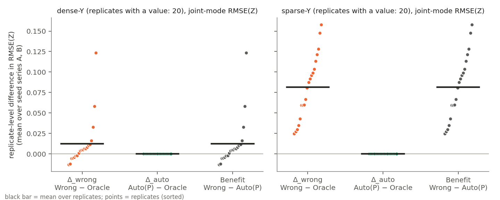
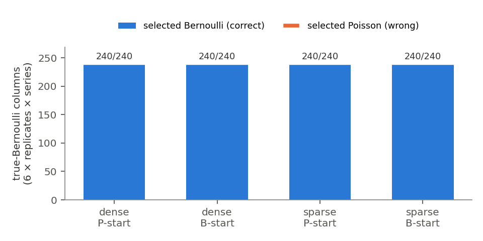

# AF1：属性分布の自動選択は、誤指定による Z 推定の悪化をどこまで防ぐか（Oracle / Auto / Wrong）

- 実験 ID：AF1（2026-11-09）／branch `experiment/auto-family-selection-z-recovery`
- 実装系列：**lineage E（E-consistent per-column、experimental prototype、本文採用不可）**。採用式どおり extra 1/2 なし
- 本実験の実行コード：git `0ec4379b325a0575ad2417b6e15d95f6ae7f630a`（`full/runinfo.json`、tracked-dirty = False）
- 数値はすべて `full/analysis/` の CSV から `analyze_auto_family_z_recovery.py` が生成したもの（§3 の表は生成ファイル `full/analysis/results_tables.md` をそのまま転記）

## 0. 結論（先に）

1. **[DERIVED] この設定では、Auto が正しく選べるかどうかは解析的にほぼ決まっている。** {0,1} の列で同じ自然パラメータ η を使うと、
   `log Bern(x|η) − log Pois(x|e^η) = e^η − log(1+e^η) > 0` が成り立つ（x ∈ {0,1}、任意の η。`log(1+u) < u` による）。
   したがって同じ loading なら Bernoulli の列スコアは常に Poisson より高く、Bernoulli の最適化が最適点に届いていれば必ず Bernoulli が選ばれる。
   この点は独立監査（research-auditor、W1）が本実験の前に指摘し、私も導出を確認した。研究問いへの答えの大部分は、データではなくこの不等式から来る。
2. **[OBSERVED] 分布選択は 160/160 fit で 12 列すべて正解だった**（真 Bernoulli 列は 960/960 で Bernoulli。Gaussian 列と Poisson 列は support gate で決まった）。開始分布（Poisson／Bernoulli）による違いはなかった（列単位で 960/960 一致）。
3. **[OBSERVED] Auto の RMSE(Z) は Oracle と bit 単位で一致した**（(系列, replicate, regime) の 80/80 で Δ_auto = 0）。refit の seed が Oracle と同じで、選ばれた族も Oracle と同じだったためである（設計上の性質、W2）。
4. **[OBSERVED] したがって Benefit = Δ_wrong である。** joint mode の RMSE(Z) で見ると、Benefit の平均は sparse-Y で 0.0816（20/20 replicate で正、95% bootstrap CI [0.0642, 0.0991]）、dense-Y で 0.0122（13/20、CI [0.0013, 0.0270]）。
   Auto が防いだ悪化の大きさは誤指定そのものの悪化の大きさに等しく、sparse で大きく dense で小さい。
5. **[INTERPRETATION] この実験が示すのは次のことまでである：Bernoulli→Poisson 誤指定という最も易しいケースでは、support gate と完全尤度スコアによる選択は確実に機能し、誤指定の損失を全て回避した。**
   選択器が誤りうる状況での有効性は、この実験からは何も言えない（例：尤度差の小さい族どうし、{0,1} しか取らない真の Poisson 列、overdispersion）。

## 1. 研究問いと仮説

研究問い：「属性データ X の観測分布を誤指定すると共有潜在構造 Z の推定精度が悪化する条件において、自動分布選択はその悪化をどの程度防げるか？」

- 事前の仮説：M1・E1 で、Wrong の悪化が sparse-Y で大きいことが分かっている。Auto が正しく選べば悪化は Oracle 水準まで消えるはずである。問題は次の 3 点である。
  - (a) 正しく選べるか
  - (b) sparse-Y で E-step が弱くなったとき、選択が崩れないか
  - (c) 開始分布に依存しないか
- 結果を見る前に固定したもの：
  - `protocol.json`（canonical sha256 `eb71be5d622c8325c3e456a812def8518e73f62ff3fc32ad1deb60b236e5bcea`）
  - `manifest.csv`（計画 320 fit）
  - 解析スクリプト（主対比・集計・区間・除外規則）

## 2. 設計（protocol.json で凍結、結果を見る前に固定）

| 項目 | 内容 |
|---|---|
| mode | CONFIRMATORY（事前固定）。ただし主対比の結論は W1 の解析的性質でほぼ決まる（§4） |
| 実装系列 | **lineage E**（E-consistent per-column、experimental prototype、本文採用不可）。採用式どおり extra 1/2 なし（`DualExpFamLSMMasked` 経由の fixed 系列） |
| データ | M1 と同一：`run_misspecification_m1.generate`（canonical-clean-mixed-v1）、n=75、d=12、K_true=K_fit=3、X = Gaussian×3 / Bernoulli×6 / Poisson×3、Y = Bernoulli、w0=−1、w=1、f_scale=√2、Gaussian-X 分散 1、data seed 1001001..1001020（20 独立データ） |
| mask | M1 と同一：`build_masks(r)`。test = 上三角ペアの 10%（seed 1341000+r）、学習候補 pool = その補集合。dense = pool の 100%、sparse = pool の 10%（seed 1342000+10r+i） |
| 手法 | Oracle（G3/B6/P3 固定）、Wrong（B 6 列を Poisson で固定＝G3/P6/P3）、Auto（Phase 9C hybrid：support gate → 列ごと候補スコア → 探索 8 反復 → 選んだ分布で fresh refit 8 反復） |
| Auto の開始 | {0,1} 列の初期分布：**Poisson 開始（primary）**／Bernoulli 開始（感度）。primary を Poisson 開始にしたのは、Wrong と同じ割り当てから出発させ、回復を初期値でなく選択規則に帰属させるため |
| EM | L=5、8 反復、`numerics_mode="consistent"`、`failure_policy="fail_fast"`、K 固定 |
| seed | 系列 A/B = E1 の model seed（1343000+r / 1344000+r）。Oracle・Wrong・Auto refit は同じ model seed。Auto の探索は 1345000+r（A）/ 1346000+r（B） |
| 主指標 | joint posterior mode（E1 の `mode`、Z0 = last、θ̂ 固定、学習 mask）の Procrustes RMSE(Z) |
| 主対比 | Δ_wrong = Wrong − Oracle、Δ_auto = Auto(P) − Oracle、Benefit = Wrong − Auto(P) |
| 統計単位 | replicate（20）。replicate 値 = 2 系列の平均（両方 OK の系列のみ）。系列・開始は独立データとして数えない |
| 区間 | replicate 値の平均の percentile bootstrap 95%（10000 回、seed 20261109） |
| 失敗 | FAILED・mode 非 OK は保持し、再試行・補完しない。対比はペア両方 OK のときのみ、除外数を併記 |
| 計画 | 320 fit（2 系列 × 20 rep × 2 regime × 4 手法）、EM 実行 480 回（Auto は探索 + refit） |

### 既存実験との関係

| 実験 | 何をしたか | AF1 との関係 |
|---|---|---|
| Phase 9C（#74） | 同条件・3 データ × 2 開始で hybrid 選択の feasibility。Bernoulli→Poisson 誤選択 0/36 | 同じ selector。**全 Y を使用（mask 未対応）**、RMSE(Z) の Oracle/Wrong 比較なし |
| Phase 9D（#75） | family + K の同時選択、誤選択 0/36 | K を変える。AF1 は K 固定 |
| M1（#134） | Oracle vs Wrong、dense/sparse、last 推定 | AF1 の Oracle/Wrong は M1/E1 と同じ呼び出し |
| E1（#141） | M1 を 2 seed 系列 × last/mean5/mode で再評価 | AF1 の Oracle/Wrong は E1 と **bit 一致**（再現確認） |
| E2a（#142） | sparse の変動を初期値 seed と MC seed に分離 | seed の効果の解釈に使う（AF1 では分離しない） |
| PR #129（未マージ） | 多 support の自動選択（Bernoulli は候補外）。mask 未対応 | **統合していない**。数値は混ぜない |

### mask の扱い（本実験の最重要リスク）

main の `run_family_exploration` / `run_hybrid_family_selection` は `train_mask` を受け取らず、探索・refit とも全 Y ペアを使っていた（`family_selection.py`：main `1b5030b` の L1081-1084 と L1253-1258）。
このままでは、sparse 条件で Auto だけが全 Y を見る不公平な比較になる。
そこで commit `2450c61` で opt-in の `train_mask` 引数を追加し、**モデル構築と refit にそのまま渡すだけ**の変更を行った。

- diff は引数追加と受け渡し 3 か所だけである。
- E-step・目的関数・候補スコア・最適化・数値安定化は変えていない。
- `None` を渡した場合の挙動は従来どおりである。

## 3. 結果（一次 CSV から自動生成）

<!-- generated by analyze_auto_family_z_recovery.py; do not edit by hand -->

### RMSE(Z)（joint mode、seed 系列 A・B をプール、fit 単位）

| regime | method | n fits | failed | value あり | mean | median | IQR (q25–q75) |
|---|---|---:|---:|---:|---:|---:|---|
| dense | oracle | 40 | 0 | 40 | 0.3466 | 0.3443 | 0.3292–0.3546 |
| dense | wrong | 40 | 0 | 40 | 0.3588 | 0.3462 | 0.3283–0.3589 |
| dense | auto_pstart | 40 | 0 | 40 | 0.3466 | 0.3443 | 0.3292–0.3546 |
| dense | auto_bstart | 40 | 0 | 40 | 0.3466 | 0.3443 | 0.3292–0.3546 |
| sparse | oracle | 40 | 0 | 40 | 0.7171 | 0.7199 | 0.6730–0.7690 |
| sparse | wrong | 40 | 0 | 40 | 0.7986 | 0.8080 | 0.7561–0.8407 |
| sparse | auto_pstart | 40 | 0 | 40 | 0.7171 | 0.7199 | 0.6730–0.7690 |
| sparse | auto_bstart | 40 | 0 | 40 | 0.7171 | 0.7199 | 0.6730–0.7690 |

### replicate 単位の paired 差（estimator = mode、系列 A・B の平均、20 replicate）

| regime | contrast | n | excluded | mean | median | IQR | >0 | =0 | <0 | 95% bootstrap CI |
|---|---|---:|---:|---:|---:|---|---:|---:|---:|---|
| dense | delta_wrong | 20 | 0 | 0.0122 | 0.0050 | -0.0030–0.0104 | 13 | 0 | 7 | [0.0013, 0.0270] |
| dense | delta_auto_p | 20 | 0 | 0.0000 | 0.0000 | 0.0000–0.0000 | 0 | 20 | 0 | [0.0000, 0.0000] |
| dense | benefit_p | 20 | 0 | 0.0122 | 0.0050 | -0.0030–0.0104 | 13 | 0 | 7 | [0.0013, 0.0270] |
| dense | delta_auto_b | 20 | 0 | 0.0000 | 0.0000 | 0.0000–0.0000 | 0 | 20 | 0 | [0.0000, 0.0000] |
| dense | benefit_b | 20 | 0 | 0.0122 | 0.0050 | -0.0030–0.0104 | 13 | 0 | 7 | [0.0013, 0.0270] |
| dense | auto_b_minus_auto_p | 20 | 0 | 0.0000 | 0.0000 | 0.0000–0.0000 | 0 | 20 | 0 | [0.0000, 0.0000] |
| sparse | delta_wrong | 20 | 0 | 0.0816 | 0.0841 | 0.0553–0.1061 | 20 | 0 | 0 | [0.0642, 0.0991] |
| sparse | delta_auto_p | 20 | 0 | 0.0000 | 0.0000 | 0.0000–0.0000 | 0 | 20 | 0 | [0.0000, 0.0000] |
| sparse | benefit_p | 20 | 0 | 0.0816 | 0.0841 | 0.0553–0.1061 | 20 | 0 | 0 | [0.0642, 0.0991] |
| sparse | delta_auto_b | 20 | 0 | 0.0000 | 0.0000 | 0.0000–0.0000 | 0 | 20 | 0 | [0.0000, 0.0000] |
| sparse | benefit_b | 20 | 0 | 0.0816 | 0.0841 | 0.0553–0.1061 | 20 | 0 | 0 | [0.0642, 0.0991] |
| sparse | auto_b_minus_auto_p | 20 | 0 | 0.0000 | 0.0000 | 0.0000–0.0000 | 0 | 20 | 0 | [0.0000, 0.0000] |

### replicate 単位の paired 差（estimator = last、系列 A・B の平均、20 replicate）

| regime | contrast | n | excluded | mean | median | IQR | >0 | =0 | <0 | 95% bootstrap CI |
|---|---|---:|---:|---:|---:|---|---:|---:|---:|---|
| dense | delta_wrong | 20 | 0 | 0.0111 | 0.0079 | -0.0058–0.0263 | 13 | 0 | 7 | [0.0024, 0.0201] |
| dense | delta_auto_p | 20 | 0 | 0.0000 | 0.0000 | 0.0000–0.0000 | 0 | 20 | 0 | [0.0000, 0.0000] |
| dense | benefit_p | 20 | 0 | 0.0111 | 0.0079 | -0.0058–0.0263 | 13 | 0 | 7 | [0.0024, 0.0201] |
| dense | delta_auto_b | 20 | 0 | 0.0000 | 0.0000 | 0.0000–0.0000 | 0 | 20 | 0 | [0.0000, 0.0000] |
| dense | benefit_b | 20 | 0 | 0.0111 | 0.0079 | -0.0058–0.0263 | 13 | 0 | 7 | [0.0024, 0.0201] |
| dense | auto_b_minus_auto_p | 20 | 0 | 0.0000 | 0.0000 | 0.0000–0.0000 | 0 | 20 | 0 | [0.0000, 0.0000] |
| sparse | delta_wrong | 20 | 0 | 0.0607 | 0.0588 | 0.0367–0.0832 | 19 | 0 | 1 | [0.0426, 0.0785] |
| sparse | delta_auto_p | 20 | 0 | 0.0000 | 0.0000 | 0.0000–0.0000 | 0 | 20 | 0 | [0.0000, 0.0000] |
| sparse | benefit_p | 20 | 0 | 0.0607 | 0.0588 | 0.0367–0.0832 | 19 | 0 | 1 | [0.0426, 0.0785] |
| sparse | delta_auto_b | 20 | 0 | 0.0000 | 0.0000 | 0.0000–0.0000 | 0 | 20 | 0 | [0.0000, 0.0000] |
| sparse | benefit_b | 20 | 0 | 0.0607 | 0.0588 | 0.0367–0.0832 | 19 | 0 | 1 | [0.0426, 0.0785] |
| sparse | auto_b_minus_auto_p | 20 | 0 | 0.0000 | 0.0000 | 0.0000–0.0000 | 0 | 20 | 0 | [0.0000, 0.0000] |

### replicate 単位の paired 差（estimator = mean5、系列 A・B の平均、20 replicate）

| regime | contrast | n | excluded | mean | median | IQR | >0 | =0 | <0 | 95% bootstrap CI |
|---|---|---:|---:|---:|---:|---|---:|---:|---:|---|
| dense | delta_wrong | 20 | 0 | 0.0103 | 0.0016 | -0.0034–0.0150 | 13 | 0 | 7 | [0.0006, 0.0215] |
| dense | delta_auto_p | 20 | 0 | 0.0000 | 0.0000 | 0.0000–0.0000 | 0 | 20 | 0 | [0.0000, 0.0000] |
| dense | benefit_p | 20 | 0 | 0.0103 | 0.0016 | -0.0034–0.0150 | 13 | 0 | 7 | [0.0006, 0.0215] |
| dense | delta_auto_b | 20 | 0 | 0.0000 | 0.0000 | 0.0000–0.0000 | 0 | 20 | 0 | [0.0000, 0.0000] |
| dense | benefit_b | 20 | 0 | 0.0103 | 0.0016 | -0.0034–0.0150 | 13 | 0 | 7 | [0.0006, 0.0215] |
| dense | auto_b_minus_auto_p | 20 | 0 | 0.0000 | 0.0000 | 0.0000–0.0000 | 0 | 20 | 0 | [0.0000, 0.0000] |
| sparse | delta_wrong | 20 | 0 | 0.0717 | 0.0677 | 0.0411–0.0889 | 20 | 0 | 0 | [0.0533, 0.0914] |
| sparse | delta_auto_p | 20 | 0 | 0.0000 | 0.0000 | 0.0000–0.0000 | 0 | 20 | 0 | [0.0000, 0.0000] |
| sparse | benefit_p | 20 | 0 | 0.0717 | 0.0677 | 0.0411–0.0889 | 20 | 0 | 0 | [0.0533, 0.0914] |
| sparse | delta_auto_b | 20 | 0 | 0.0000 | 0.0000 | 0.0000–0.0000 | 0 | 20 | 0 | [0.0000, 0.0000] |
| sparse | benefit_b | 20 | 0 | 0.0717 | 0.0677 | 0.0411–0.0889 | 20 | 0 | 0 | [0.0533, 0.0914] |
| sparse | auto_b_minus_auto_p | 20 | 0 | 0.0000 | 0.0000 | 0.0000–0.0000 | 0 | 20 | 0 | [0.0000, 0.0000] |

### 系列別の paired 差（mode、primary の 3 対比）

| series | regime | contrast | n | mean | median | >0 | =0 | <0 |
|---|---|---|---:|---:|---:|---:|---:|---:|
| A | dense | delta_wrong | 20 | 0.0152 | 0.0064 | 13 | 0 | 7 |
| A | dense | delta_auto_p | 20 | 0.0000 | 0.0000 | 0 | 20 | 0 |
| A | dense | benefit_p | 20 | 0.0152 | 0.0064 | 13 | 0 | 7 |
| A | dense | delta_auto_b | 20 | 0.0000 | 0.0000 | 0 | 20 | 0 |
| A | sparse | delta_wrong | 20 | 0.0760 | 0.0784 | 18 | 0 | 2 |
| A | sparse | delta_auto_p | 20 | 0.0000 | 0.0000 | 0 | 20 | 0 |
| A | sparse | benefit_p | 20 | 0.0760 | 0.0784 | 18 | 0 | 2 |
| A | sparse | delta_auto_b | 20 | 0.0000 | 0.0000 | 0 | 20 | 0 |
| B | dense | delta_wrong | 20 | 0.0092 | 0.0035 | 13 | 0 | 7 |
| B | dense | delta_auto_p | 20 | 0.0000 | 0.0000 | 0 | 20 | 0 |
| B | dense | benefit_p | 20 | 0.0092 | 0.0035 | 13 | 0 | 7 |
| B | dense | delta_auto_b | 20 | 0.0000 | 0.0000 | 0 | 20 | 0 |
| B | sparse | delta_wrong | 20 | 0.0871 | 0.0773 | 20 | 0 | 0 |
| B | sparse | delta_auto_p | 20 | 0.0000 | 0.0000 | 0 | 20 | 0 |
| B | sparse | benefit_p | 20 | 0.0871 | 0.0773 | 20 | 0 | 0 |
| B | sparse | delta_auto_b | 20 | 0.0000 | 0.0000 | 0 | 20 | 0 |

### 分布選択（seed 系列 A・B をプール）

| regime | start | fits | failed | 全 12 列正解 | Bernoulli 列→Bernoulli | Bernoulli 列→Poisson | gate 決定列 | score 決定列 | score 決定列の正解 | 真 Poisson 列で score 決定 | 最小 margin | margin 中央値 | 最終反復で未収束の score 列 | 候補未収束を含む fit |
|---|---|---:|---:|---:|---:|---:|---:|---:|---:|---:|---:|---:|---:|---:|
| dense | Poisson（primary） | 40 | 0 | 40 | 240/240 | 0/240 | 240 | 240 | 240 | 0 | 44.99 | 52.42 | 51 | 40 |
| dense | Bernoulli | 40 | 0 | 40 | 240/240 | 0/240 | 240 | 240 | 240 | 0 | 45.08 | 52.51 | 53 | 40 |
| sparse | Poisson（primary） | 40 | 0 | 40 | 240/240 | 0/240 | 240 | 240 | 240 | 0 | 44.81 | 53.70 | 67 | 40 |
| sparse | Bernoulli | 40 | 0 | 40 | 240/240 | 0/240 | 240 | 240 | 240 | 0 | 44.55 | 53.43 | 55 | 40 |

- 開始分布間の列単位一致: 960/960
- fit: OK 320 / 記録 320、FAILED 0、joint mode 非 OK 0
- E1 との Oracle/Wrong RMSE 再現: 比較 480 値、最大絶対差 0.0
- integrity pass: True

### 事後に追加した記述表（post-hoc、事前登録外）

held-out Y（test ペア、joint mode の plug-in η、fit 単位、2 系列プール）

| regime | method | n | mean log score | mean AUC | − Oracle（log score）平均 | Oracle 未満 | Oracle と同値 |
|---|---|---:|---:|---:|---:|---:|---:|
| dense | oracle | 40 | -0.5219 | 0.7768 | 0.0000 | 0 | 40 |
| dense | wrong | 40 | -0.5248 | 0.7733 | -0.0028 | 30 | 0 |
| dense | auto_pstart | 40 | -0.5219 | 0.7768 | 0.0000 | 0 | 40 |
| dense | auto_bstart | 40 | -0.5219 | 0.7768 | 0.0000 | 0 | 40 |
| sparse | oracle | 40 | -0.6051 | 0.6425 | 0.0000 | 0 | 40 |
| sparse | wrong | 40 | -0.6114 | 0.6246 | -0.0063 | 30 | 0 |
| sparse | auto_pstart | 40 | -0.6051 | 0.6425 | 0.0000 | 0 | 40 |
| sparse | auto_bstart | 40 | -0.6051 | 0.6425 | 0.0000 | 0 | 40 |

候補 loading 最適化（BFGS、収束判定 grad_inf ≤ 1e-8）の未収束（全 8 反復の trace 行）

| candidate | regime | trace 行 | 未収束行 | 未収束時 grad_inf 中央値 | 最大 |
|---|---|---:|---:|---:|---:|
| bernoulli | dense | 3840 | 324 | 2.96e-08 | 4.39e-07 |
| bernoulli | sparse | 3840 | 302 | 3.25e-08 | 4.40e-07 |
| poisson | dense | 3840 | 573 | 3.49e-08 | 1.03e-06 |
| poisson | sparse | 3840 | 526 | 4.16e-08 | 8.20e-07 |

- 全 trace 行（全反復）の margin（−2 スケール）の最小値: 40.69（7680 行）
- auto_pstart: score 決定列 480、最初に族が変わった反復 = ['1']、反復中の変更回数 = ['1']
- auto_bstart: score 決定列 480、最初に族が変わった反復 = ['変化なし']、反復中の変更回数 = ['0']





## 4. 問い A〜I への回答

| 問い | 回答 | 区分 |
|---|---|---|
| A. 正しい分布を選べたか | 160/160 fit で 12 列すべて正解。真 Bernoulli 列は dense・sparse、両開始とも 240/240。全反復の margin（−2 スケール）の最小値は 40.69 | OBSERVED（§0-1 の DERIVED による予想どおり） |
| B. Auto の RMSE(Z) は Oracle にどれだけ近いか | 完全に一致した（Δ_auto = 0 が 80/80）。mode の平均 RMSE は dense 0.3466、sparse 0.7171 で Oracle と同じ値 | OBSERVED。設計上、同じ族を選べば refit は Oracle と同一の計算になる |
| C. Wrong よりどれだけ改善したか | Benefit の平均は sparse 0.0816（20/20、CI [0.0642, 0.0991]）、dense 0.0122（13/20、CI [0.0013, 0.0270]）。fit 単位の平均 RMSE では、sparse で 0.7986 → 0.7171 | OBSERVED |
| D. dense と sparse で変わったか | 選択の正しさは変わらない（両方 240/240）。変わるのは防げる損失の大きさで、sparse の Δ_wrong は dense の約 6.7 倍（0.0816 / 0.0122） | OBSERVED |
| E. 初期分布・seed による変動 | 開始分布による差は 0（列は 960/960 一致、Auto(B) − Auto(P) = 0 が 80/80）。Poisson 開始では全 480 列が反復 1 で Bernoulli に切り替わり、以後は変化しない。seed 系列の間では Δ_wrong が変動する：sparse は A 0.0760（18/20）、B 0.0871（20/20）。dense は A 0.0152、B 0.0092（ともに 13/20） | OBSERVED。seed 系列の変動は初期値と MC の両方を含む（分離は E2a で実施） |
| F. 選択が正しいのに RMSE が悪いケース | Oracle と比べて悪いケースはない（Δ_auto はすべて 0）。ただし Oracle 自体の RMSE は replicate 間で大きくばらつく（sparse の IQR 0.6730–0.7690） | OBSERVED |
| G. 誤選択なのに影響が小さいケース | 誤選択が 0 件なので、Auto では観測できない。参考として、意図的に誤指定した Wrong でも dense では 7/20 replicate で Oracle より RMSE が小さく、誤指定の影響は小さく符号も揺れる | OBSERVED（Wrong 側の記述） |
| H. 既存結果との整合 | Oracle/Wrong は E1 と 480 値で完全に一致した（最大差 0.0）。したがって E1 の mode の Δ をそのまま再現している（A：dense 0.0152 13/20、sparse 0.0760 18/20。B：dense 0.0092、sparse 0.0871 20/20）。last の系列 A は M1 と同じ計算である。Phase 9C・9D の「Bernoulli→Poisson 誤選択 0/36」と整合し、それを学習 mask 付き・20 データ・2 regime に拡張した。PR #129 とは比較しない（候補集合に Bernoulli を含まず、mask にも対応していないため） | FACT / OBSERVED |
| I. 一般化できないこと | §5 を参照 | — |

## 5. 限界・主張できないこと

- **選択の成功は §0-1 の不等式でほぼ保証されている。** 「自動選択は誤指定を防ぐ」と一般化して書かない。言えるのは「{0,1} 列の Bernoulli/Poisson 判別では」までである。
- 次の条件は未検証である。
  - 候補が近い族どうし（例：Poisson と過分散 count、Gaussian と heavy-tail）
  - 真の Poisson 列が {0,1} しか取らない場合。このとき選択器は Bernoulli を選ぶ。本データでは真 Poisson 列の最大値が全 replicate で 1 を超えていたため gate で決まり、この状況は起きなかった（`full/data_mask_audit.csv` の `x_col_max`）。
  - 実データ
  - n・d・K・族構成を変えた場合
- Auto と Oracle の bit 一致は、refit の seed を Oracle と共有した設計の帰結である。「Auto の推定が Oracle と同等に安定している」ことの独立な証拠ではない。
- 合成条件は 1 つ、replicate は 20 である。seed 系列 A/B と 2 つの開始は同じデータの再利用であり、独立データではない。
- MCEM は 8 反復で収束していない（Phase 9 以来の既知事項）。joint mode は θ̂ を固定した点推定である。
- 候補 loading の BFGS は、一部の反復で許容値 1e-8 に届かなかった（grad_inf の最大 1.03e-6、§3 の事後表）。margin の最小値 40.69 に比べて無視できる大きさなので、選択には影響しないと判断し、WARNING として記録した。
- Auto の refit は `compute_strict_Q=True`、Oracle/Wrong は `False` で実行した。Q は乱数を使わない純計算なので推定経路は変わらない（bit 一致で確認）。
- lineage E の prototype であり、本文には採用できない。旧 0.5 系列や fixed 系列の数値と同じ表に並べない。
- 書いてはいけない表現の例：
  - 「自動分布選択は、分布誤指定による Z 推定の悪化を一般に防ぐ」
  - 「Auto は Oracle と同等の性能を一般に達成する」
  - 「実データでも有効」
  - 「40 独立実験」

## 6. 技術的妥当性（technical validity）

| 項目 | 結果 | 根拠 |
|---|---|---|
| fit | 320/320 OK。FAILED 0、joint mode 非 OK 0、retry・置換・seed rescue 0、NaN 0 | `full/fit_runs.csv`、`full/analysis/summary.json` |
| データ・mask の同一性 | 各セルで X・Y・Z_true・train・test の hash が 4 手法すべてで一致。train∩test = 0、sparse ⊂ dense、mask は対称で対角なし | `full/data_mask_audit.csv`、`summary.json` の `integrity` |
| Auto の mask | 全 160 Auto fit で、refit model の train_mask が当該 regime の mask と一致した。探索段に同じ mask が渡ることは test で確認した | `fit_runs.csv` の `refit_mask_matches`、`test_auto_family_z_recovery.py` |
| 漏洩 | mask 外の Y（test を含む）を反転しても、探索・候補スコア・選択・refit が bit 一致した。mask なしでは結果が変化することも確認した | `test_masked_out_y_cannot_change_anything` |
| 再現性 | 正式 smoke は scratch smoke と bit 一致した。Oracle/Wrong は E1 と 480 値で差 0.0 | `full/analysis/e1_reproduction.csv` |
| 候補スコア | Bernoulli・Poisson の列スコアが scipy の logpmf と相対 1e-10 で一致した（基底測度を含む） | `test_candidate_score_is_the_complete_loglik` |
| 再開 | 中断・再実行はなかった（`attempts.csv` では全 fit が "first and only execution"） | `full/attempts.csv`、`full/progress.jsonl` |

**事前登録に関する開示**

- protocol と解析規則を確定した後、正式 smoke の前に、同じ protocol hash の smoke を scratch 領域で 1 回実行した（系列 A・rep01、8 fit）。その後に修正したのは図のラベル位置だけである。
- 本実験の前に、独立監査の指摘 D2（集計列の数え方）と D3（再開時の重複行）を修正した。どちらも protocol と主対比を変えていない。
- held-out Y・候補収束・切り替え反復の表は、本実験の結果を見た後に追加した**事後の記述表**である（§3 末尾に明記）。

## 7. 成果物

| ファイル | 内容 |
|---|---|
| `protocol.json` / `manifest.csv` | 凍結した protocol と、全 320 fit の計画 |
| `full/runinfo.json` | git SHA・branch・Python・numpy/scipy/sklearn・platform・requirements の sha256・protocol の sha256・seed・実行時間 |
| `full/fit_runs.csv` | fit ごとの生結果（状態・hash・θ̂・retry 等・mode 診断・選択結果・警告・npz の sha256） |
| `full/fit_estimators.csv` | fit × 推定量（last/mean5/mode）ごとの RMSE(Z)・gram 相関・held-out Y |
| `full/selection_columns.csv` | Auto fit × 12 列：gate、初期族、選択族、正誤、最終スコア・margin・収束 |
| `full/selection_trace.csv` | Auto の全反復 × 曖昧列の選択履歴（候補スコア・margin・BFGS 診断・loading の sha256） |
| `full/candidate_scores.csv` | 最終反復の候補ごとのスコアと最適化診断 |
| `full/data_mask_audit.csv` | replicate ごとのデータ・mask の hash と検査結果 |
| `full/attempts.csv` / `full/progress.jsonl` | 実行状態（STARTED/FINISHED）と試行の区別 |
| `full/analysis/method_comparison.csv` | Oracle・Auto・Wrong の比較（系列 × replicate × regime × 推定量） |
| `full/analysis/paired_contrasts_by_series.csv` / `paired_contrasts_replicate.csv` | paired 差（系列別／replicate 単位） |
| `full/analysis/summary_contrasts.csv` / `rmse_summary.csv` / `selection_summary.csv` / `start_agreement.csv` | 集計 |
| `full/analysis/failures_and_warnings.csv` | 失敗・mode 非 OK・候補未収束の WARNING・Python 警告 |
| `full/analysis/e1_reproduction.csv` | E1 との再現確認 |
| `full/analysis/selection_vs_rmse_cases.csv` | 問い F・G 用のケース表 |
| `full/analysis/posthoc_*.csv` | 事後の記述表 |
| `smoke/` | 正式 smoke（8 fit） |
| repository 外：fit ごとの状態 | `D:\tento\kennkyu_artifacts\auto_family_z_recovery_af1_20261109\full\fits\*.npz`（320 個、計 3.9 MB）。各 sha256 は `fit_runs.csv` の `state_sha256` |
| repository 外：実行ログ | `D:\tento\kennkyu_artifacts\af1_full_console.log`（sha256 `cd9557cf5db72b737d379ca2d019c3d25d90008aa807d2974f22cc9a9ef2b6cf`） |

コード：
- `expfam/src/experimental/run_auto_family_z_recovery.py`（runner）
- `analyze_auto_family_z_recovery.py`（集計・図）
- `test_auto_family_z_recovery.py`（テスト）
- `family_selection.py`（mask の受け渡し）

## 8. 再現コマンド（repository root、Python 3.13.14、`requirements.txt`）

```bash
python -m pytest -q expfam/src/experimental/test_auto_family_z_recovery.py
# 新しい出力先で再実行する（既存の結果は上書きしない）
python expfam/src/experimental/run_auto_family_z_recovery.py --write-protocol --out-root <new_dir>
python expfam/src/experimental/run_auto_family_z_recovery.py --smoke   --out-root <new_dir> --state-root <new_state_dir>
python expfam/src/experimental/run_auto_family_z_recovery.py --execute --out-root <new_dir> --state-root <new_state_dir>
# 中断した場合：FAILED の fit は再実行しない。STARTED のまま止まった fit だけを同じ seed で再実行し、attempts.csv に記録する
python expfam/src/experimental/run_auto_family_z_recovery.py --execute --resume --out-root <new_dir> --state-root <new_state_dir>
# 集計と図を一次 CSV から再生成する
python expfam/src/experimental/analyze_auto_family_z_recovery.py --stage-dir expfam/results/auto_family_z_recovery/af1_20261109/full --overwrite
```

## 9. 次に人間が判断すること（新しい実験は実行していない）

1. **AF1 の位置づけ**：この結果を、限定付きの確認として使うか。すなわち「Bernoulli/Poisson では選択が解析的に保証されており、実際にも誤指定の損失を完全に回避した」という位置づけである。
2. **選択器が失敗しうる条件で実験するか**（優先度高）：候補間の尤度差が解析的に決まらない設定（例：count 列で Poisson と過分散 count、連続列で Gaussian と別の族）でこそ、「Auto がどれだけ防げるか」が経験的な問いになる。PR #129（未マージ、mask 非対応）の候補集合を使う場合は、先に mask への対応が必要である。
3. **gate の盲点を調べるか**：真の Poisson 列が {0,1} しか取らない（λ が小さい）場合、Auto は Bernoulli を選ぶ。そのことが Z 推定にどう影響するかである。

## 10. Notion 掲載用の説明文

**AF1：属性分布の自動選択と潜在構造 Z の推定（2026-11-09）**

*実験条件*
- データ：M1 と同じ合成データ 20 個。n=75、d=12、K=3（固定）。X は Gaussian 3 列・Bernoulli 6 列・Poisson 3 列、Y は Bernoulli、w0=−1、w=1。
- Y の学習ペア：dense（学習候補の 100%）と sparse（10%）の 2 条件。test ペア 10% は全手法で共通。
- 比較する 3 手法：
  - Oracle：真の分布で固定
  - Wrong：Bernoulli 6 列を Poisson で固定
  - Auto：列ごとに分布を自動選択し、選んだ分布で再推定する（主解析は Poisson 開始）
- 推定：E1 の 2 つの seed 系列、L=5、探索・再推定とも 8 反復。
- 主指標：Z の joint posterior mode の Procrustes RMSE。
- 実装系列：lineage E（experimental prototype、本文採用不可）。
- 証拠：`expfam/results/auto_family_z_recovery/af1_20261109/`

*一次結果（OBSERVED）*
- 320/320 fit が成功した（retry 0）。
- Auto は 160/160 fit で 12 列すべての分布を正しく選んだ（真 Bernoulli 列 960/960）。開始分布によらず同じ結果だった。
- Auto の RMSE(Z) は Oracle と完全に一致した。
- Wrong − Auto（= Wrong − Oracle）の平均は、sparse-Y で 0.0816（20/20 データで正、95% CI [0.0642, 0.0991]）、dense-Y で 0.0122（13/20、CI [0.0013, 0.0270]）だった。

*考察（INTERPRETATION）*
- {0,1} の列では、同じ η に対して Bernoulli の対数尤度が常に Poisson より高い（差 = e^η − log(1+e^η) > 0）。そのため、この設定で選択が成功することは数理的にほぼ保証されている。
- この実験から分かるのは、そのような易しい判別では自動選択が誤指定の損失を全て回避できる、ということまでである。防げた損失は、Y が疎なほど大きかった。
- 尤度の差が小さい族どうしの選択や、実データでの有効性は検証していない。
