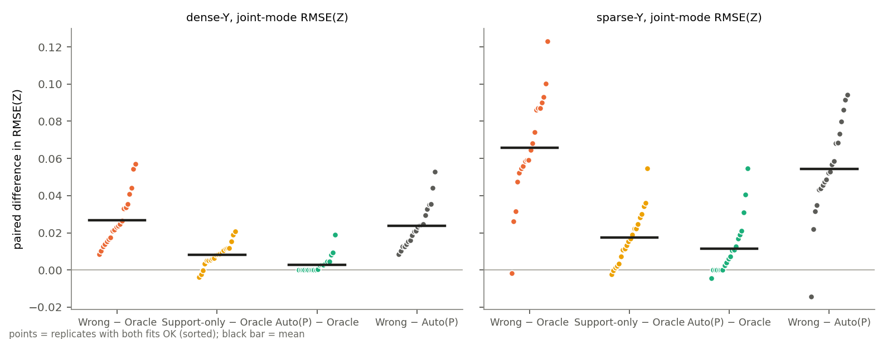
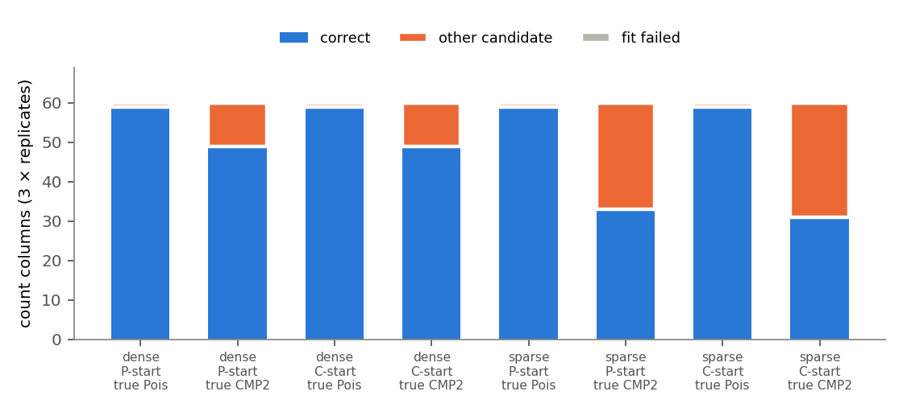

# AF2：自動分布選択が本当に必要な条件 — Poisson と COM-Poisson（ν=2）の選択と Z の推定

- 実験 ID：AF2（2026-11-10）、Part A（理論的限界の確認）を含む
- branch：`experiment/af2-poisson-cmp-selection`（AF1 = PR #166 の上に stack）
- 実装系列：**lineage E（E-consistent per-column）と PR #129 の generic model（experimental prototype、本文採用不可）**。採用式どおり extra 1/2 なし
- PR #129 の扱い：**マージしていない**。ソース 5 ファイルとテスト 3 ファイルを byte 単位で同一のまま取り込み（commit `624adee`、blob SHA は `protocol.json` の `pr129`）、mask の受け渡しだけを追加した（commit `0d969a8`）
- 本実験の実行コード：git `9eb531c1e72c8310b89fe364ea321e037a075ee9`（`full/runinfo.json`、tracked-dirty = False）
- 数値はすべて一次 CSV から生成した表に基づく。§3 の表は `full/analysis/results_tables.md` と `af2_part_a_20261110/part_a_tables.md` をそのまま転記した

## 0. 結論（先に）

1. **[DERIVED] AF1 で選択器が失敗しえなかった理由は、{0,1} 列での点ごとの優越にある。** Poisson と CMP(ν=2) の間にはこの優越がなく、選択はデータに依存する統計的な判断になる（§2）。
2. **[DERIVED + 数値計算] {0,1} だけの真 Poisson 列は、本研究のモデル（切片なし）ではほぼ起きない。** n=75 での確率は 1.01e-10 以下である。ただし負の切片を仮定すると急に起きる（b=−3、‖f‖=1 で 0.605）。その領域では Poisson 候補は {0,1} 列でも 2 以上を含む列でも負け、**切片の欠如が分布選択と交絡する**（§3.1、監査 W2）。
3. **[OBSERVED] AF2 の Auto（Poisson 開始）は count 列の分布を、dense で 108/120、sparse で 92/120 正しく選んだ。** 誤りはほぼすべて「真 CMP2 → Poisson」の方向だった（dense 11/60、sparse 27/60）。真 Poisson 列は両 regime とも 59/60 で正解。**Y が疎になると、X 列の分布選択まで悪化した。**
4. **[OBSERVED] RMSE(Z)（joint mode）で、Auto は Wrong（count 6 列すべて逆）より大きく改善した。** Wrong − Auto は dense 0.0238（20/20、CI [0.0190, 0.0290]）、sparse 0.0542（19/20、CI [0.0427, 0.0649]）。
   一方、実務上の基準である Support-only（count 列はすべて Poisson）に対する改善は小さい：dense 0.0051（15/20、CI [0.0023, 0.0079]）、sparse 0.0059（13/20、CI [0.0013, 0.0109]）。
   Auto − Oracle は dense 0.0029、sparse 0.0116 で、Oracle には届かない。
5. **[INTERPRETATION] 自動選択が役立つ大きさは、比較対象と Y の観測量で大きく変わる。** 完全な誤指定（Wrong）からはほとんどの損失を回避した。しかし、もっともらしい既定（Support-only）からの上積みは小さく、sparse ではその上積みの多くが誤選択で失われた。sparse で 2 列以上を誤選択した replicate では、Support-only より良くならなかった（§3 事後表）。

## 1. 研究問い

AF1 では、{0,1} 列で Bernoulli が Poisson を解析的に支配するため、自動選択が失敗しえなかった。AF2 では、選択がデータに依存する判断になる Poisson と CMP(ν=2) を対象に、次の 2 点を調べる。

- 自動選択はどれだけ正しく選べるか
- Z 推定の悪化をどれだけ防げるか

Part A では、AF1 の限界である「{0,1} しか観測されない真 Poisson 列」がいつ起きるか、そのとき選択器が何を選ぶかを、数式と最小限のシミュレーションで確かめる（MCEM なし）。

## 2. 数式的根拠（DERIVED）

### 2.1 AF1 の限界：{0,1} 列ではどの loading でも順序が固定される

x ∈ {0,1} では log x! = 0 なので、同じ自然パラメータ η について次が成り立つ。

- `log Bern(x|η) − log Pois(x|η) = A_P(η) − A_B(η) = e^η − log(1+e^η) > 0`
- `log CMP2(x|η) − log Pois(x|η) = A_P(η) − A_C2(η) = e^η − log Σ_x e^{ηx}/(x!)² > 0`
  （Σ_x e^{ηx}/(x!)² < Σ_x e^{ηx}/x! = exp(e^η) による）

したがって {0,1} しか観測されない列では、どの loading でも Poisson のスコアは Bernoulli・CMP2 より低い。
- main の selector（AF1）は、support gate が {0,1} 列を {Bernoulli, Poisson} に送るので必ず Bernoulli を選ぶ。
- PR #129 の count selector は、候補を {Poisson, CMP2} に絞ると必ず CMP2 を選ぶ。

数値確認：η ∈ [−10, 5] の 3001 点で、どちらの差も正（`af2_part_a_20261110/orderings_01.csv`）。

### 2.2 {0,1} だけの真 Poisson 列はどれだけ起きるか

本モデルでは η_i = f^T z_i、z_i ~ N(0, I) が iid である。したがって f を与えると x_i も iid になり、次が成り立つ。

`P(max_i x_i ≤ 1 | f) = (E[(1 + e^η) e^{−e^η}])^n,  η ~ N(b, ‖f‖²)`

本モデルは切片 b = 0 で、このときは λ の中央値が 1 になる。この確率は Gauss-Hermite 求積で計算し、Monte Carlo（2 万回）と一致することを確かめた（`p_all01_quadrature.csv`、`p_all01_mc_check.csv`）。

### 2.3 Poisson と CMP(ν=2) には点ごとの優越がない

x ≥ 2 では `log CMP2 − log Pois = −log x! + A_P(η) − A_C2(η)` となり、符号は x と η によって変わる（`test_part_a_orderings_on_01_data`）。
したがって AF1 のような「どの loading でも片方が勝つ」構造はなく、選択はデータに依存する統計的な判断になる。

PR #129 の較正によると、1 観測あたりの期待 KL（射影）は 0.027〜0.061 と小さい（τ = 0.25〜2）。n = 75 で列ごとの対数尤度比はおおむね数単位にとどまる。

### 2.4 E1 の joint mode を CMP モデルに使ってよい理由

- `laplace_k_criterion` は X の score を `X − A'(η)` で計算する。AF2 の分布はすべて T(x) = x なので、これは正しい。
- Φ には Poisson ラベルの列（CMP 列を含む）に −Σ log x! が余分に加わる。ただしこれは Z に依存しない定数なので、mode・勾配・Hessian は変わらない（監査 D3）。
- 勾配と負 Hessian は、有限差分と相対 1e-5 / 1e-4 以内で一致した（`test_joint_mode_evaluator_is_valid_for_the_generic_cmp_model`）。
- **`mode_phi` は真の対数密度ではないので、手法間で比べない。**

## 2b. 設計（`protocol.json`、canonical sha256 `889557abbbf939bcb31064b5bf0f2cf85acaf4f55b5f54b7ccb552591e8d1c17`、結果を見る前に固定）

| 項目 | 内容 |
|---|---|
| mode | CONFIRMATORY（Part A は理論確認と特徴づけ） |
| データ | PR #129 の生成器 `generate_multisupport_data`。n=75、K=3、d=9：Gaussian×3（τ=1）、Poisson×3、CMP(ν=2)×3（τ=2）。Y は Bernoulli（w0=−1、w=1）。20 データ（seed 1661001+r） |
| τ の根拠 | PR #129 の値を使った。Gaussian は `tau_real_mixed`=1、count は較正値 2.0（PR #129 では "EASY" と呼ばれていたが、AF2 では count 列に強い潜在信号を持たせるために選んだ） |
| mask | M1・AF1 と同じ規則と seed（`m1.build_masks(r)`）。test 10%、dense = 学習 pool の 100%、sparse = 10% |
| 候補 | count 列：{Poisson, CMP2}、Gaussian 列は gate で決定。候補最適化は trust-exact（PR #129 の本実験と同じ） |
| 手法 | Oracle（真）、Wrong（count 6 列の Poisson と CMP2 を入れ替え）、Support-only（PR #129 の規則＝最初の許容候補＝すべて Poisson）、Auto（hybrid、Poisson 開始＝primary、CMP2 開始＝感度） |
| seed | model seed 1662000+r（全 fit と Auto の refit で共通）、探索 seed 1663000+r（両開始で共通）。seed 系列は 1 つ |
| EM | L=5、探索 8 反復・refit 8 反復、Newton α=0.5、fail-fast、K 固定 |
| 主指標 | joint mode（E1 の評価器）の Procrustes RMSE(Z)。CMP モデルでの妥当性は有限差分で確認（§2.4） |
| 主対比 | Δ_wrong = Wrong − Oracle、Δ_auto = Auto − Oracle、Benefit = Wrong − Auto。主要な副対比は Support-only − Oracle と Support-only − Auto |
| 区間 | replicate 単位（20）の平均について percentile bootstrap 95%（10000 回、seed 20261110） |
| 失敗 | 保持し、再試行・補完はしない。PR #129 の規則により、候補が失敗したらその Auto fit を停止する |
| 計画 | 200 fit（20 × 2 regime × 5 手法）、EM 実行 280 回 |

**Support-only と Wrong の関係**：Support-only はすべての count 列を Poisson で当てはめる。これは CMP2 列だけを誤指定することに等しく、AF1 の Wrong に相当する一方向の誤指定である。AF2 の Wrong は 6 列すべてを逆にするため、Support-only より強い誤指定になる。

## 3. 結果

### 3.1 Part A（`af2_part_a_20261110/`、MCEM なし、seed 20261110）

<!-- generated by af2_part_a_zero_one_poisson.py --tables-only; do not edit by hand -->

| x | η の範囲 | min(log Bern − log Pois) | min(log CMP2 − log Pois) |
|---|---|---:|---:|
| 0 | [-10, 5] | 1.031e-09 | 5.153e-10 |
| 1 | [-10, 5] | 1.031e-09 | 5.153e-10 |

P(真 Poisson 列が {0,1} だけ)（n = 75、Gauss-Hermite）。**b = 0 が本研究のモデル**、b < 0 はモデル外の例示

| b ／ ‖f‖ | 0 | 0.5 | 1 | 1.41 | 2 | 2.45 |
|---|---:|---:|---:|---:|---:|---:|
| 0 | 1.01e-10 | 1.91e-12 | 3.12e-15 | 6.52e-17 | 1.89e-18 | 3.16e-19 |
| -1 | 0.0166 | 0.00328 | 2.34e-05 | 1.56e-07 | 3.17e-10 | 7.46e-12 |
| -2 | 0.532 | 0.38 | 0.0733 | 0.00437 | 2.8e-05 | 6.33e-07 |
| -3 | 0.914 | 0.866 | 0.605 | 0.219 | 0.0122 | 0.000692 |
| -4 | 0.988 | 0.98 | 0.922 | 0.709 | 0.201 | 0.0349 |

| b | ‖f‖ | n | MC（2 万回） | 求積 |
|---:|---:|---:|---:|---:|
| -2 | 1 | 75 | 0.0747 | 0.07327 |
| -3 | 1 | 75 | 0.6104 | 0.6045 |
| -3 | 0.5 | 40 | 0.9259 | 0.9259 |
| 0 | 0 | 20 | 0.00185 | 0.002161 |

真 Z（L = 1）での選択（‖f‖ = 1、n = 75、各 b で 200 列、全 0 列は除外）

| b | 列の種類 | 列数 | main：Bernoulli | main：Poisson | count：Poisson | count：CMP2 | count 失敗 |
|---:|---|---:|---:|---:|---:|---:|---:|
| -2 | all_01 | 14 | 14 | 0 | 0 | 14 | 0 |
| -2 | has_value_ge2 | 186 | 0 | 186 | 0 | 186 | 0 |
| -3 | all_01 | 114 | 114 | 0 | 0 | 114 | 0 |
| -3 | has_value_ge2 | 85 | 0 | 85 | 0 | 85 | 0 |

**Part A の読み方**

- b = 0（本研究のモデル）では、n = 75 で {0,1} だけの真 Poisson 列が出る確率は 1.01e-10 以下である。AF1 の gate の盲点は、本モデルの合成データでは実質的に起きない。
- b < 0 は**モデルの外**での例示である。ここでは Poisson 候補が、{0,1} 列（main：全列 Bernoulli、count：全列 CMP2）でも、2 以上を含む列（count：186/186 と 85/85 が CMP2）でも負けた。
  - 原因の解釈：切片のない η = f^T z では、Poisson の平均の中央値は 1 になる。CMP2 は η=0 での平均が小さいので、欠けている負の切片を吸収してしまう。
  - したがってこれは Poisson と CMP2 の判別ではなく、**切片の誤指定が分布選択を偏らせる**例である（監査 W2）。選択精度の証拠には使わない。

### 3.2 AF2 本実験（`full/`）

<!-- generated by analyze_af2_poisson_cmp.py; do not edit by hand -->

### RMSE(Z)（joint mode、fit 単位）

| regime | method | n fits | failed | value あり | mean | median | IQR |
|---|---|---:|---:|---:|---:|---:|---|
| dense | oracle | 20 | 0 | 20 | 0.2725 | 0.2755 | 0.2562–0.2847 |
| dense | wrong | 20 | 0 | 20 | 0.2991 | 0.2968 | 0.2910–0.3078 |
| dense | support_only | 20 | 0 | 20 | 0.2805 | 0.2829 | 0.2627–0.2951 |
| dense | auto_first | 20 | 0 | 20 | 0.2754 | 0.2780 | 0.2573–0.2874 |
| dense | auto_last | 20 | 0 | 20 | 0.2746 | 0.2785 | 0.2566–0.2874 |
| sparse | oracle | 20 | 0 | 20 | 0.4108 | 0.4107 | 0.3933–0.4361 |
| sparse | wrong | 20 | 0 | 20 | 0.4766 | 0.4726 | 0.4536–0.4967 |
| sparse | support_only | 20 | 0 | 20 | 0.4283 | 0.4325 | 0.4137–0.4441 |
| sparse | auto_first | 20 | 0 | 20 | 0.4224 | 0.4217 | 0.4047–0.4432 |
| sparse | auto_last | 20 | 0 | 20 | 0.4237 | 0.4237 | 0.4047–0.4443 |

### replicate 単位の paired 差（mode、20 replicate）

| regime | contrast | n | excluded | mean | median | IQR | >0 | =0 | <0 | 95% bootstrap CI |
|---|---|---:|---:|---:|---:|---|---:|---:|---:|---|
| dense | delta_wrong | 20 | 0 | 0.0267 | 0.0233 | 0.0162–0.0341 | 20 | 0 | 0 | [0.0210, 0.0329] |
| dense | delta_auto | 20 | 0 | 0.0029 | 0.0002 | 0.0000–0.0038 | 10 | 10 | 0 | [0.0011, 0.0052] |
| dense | benefit_wrong | 20 | 0 | 0.0238 | 0.0220 | 0.0149–0.0302 | 20 | 0 | 0 | [0.0190, 0.0290] |
| dense | delta_support_only | 20 | 0 | 0.0080 | 0.0084 | 0.0052–0.0116 | 17 | 0 | 3 | [0.0054, 0.0107] |
| dense | benefit_support_only | 20 | 0 | 0.0051 | 0.0050 | 0.0016–0.0097 | 15 | 0 | 5 | [0.0023, 0.0079] |
| dense | delta_auto_last | 20 | 0 | 0.0022 | 0.0000 | 0.0000–0.0033 | 9 | 11 | 0 | [0.0009, 0.0036] |
| dense | auto_last_minus_auto_first | 20 | 0 | -0.0007 | 0.0000 | 0.0000–0.0000 | 2 | 16 | 2 | [-0.0029, 0.0008] |
| sparse | delta_wrong | 20 | 0 | 0.0658 | 0.0619 | 0.0541–0.0871 | 19 | 0 | 1 | [0.0533, 0.0777] |
| sparse | delta_auto | 20 | 0 | 0.0116 | 0.0066 | 0.0000–0.0174 | 14 | 4 | 2 | [0.0057, 0.0186] |
| sparse | benefit_wrong | 20 | 0 | 0.0542 | 0.0524 | 0.0437–0.0697 | 19 | 0 | 1 | [0.0427, 0.0649] |
| sparse | delta_support_only | 20 | 0 | 0.0176 | 0.0161 | 0.0062–0.0255 | 18 | 0 | 2 | [0.0116, 0.0240] |
| sparse | benefit_support_only | 20 | 0 | 0.0059 | 0.0038 | -0.0000–0.0110 | 13 | 2 | 5 | [0.0013, 0.0109] |
| sparse | delta_auto_last | 20 | 0 | 0.0129 | 0.0099 | 0.0001–0.0195 | 15 | 3 | 2 | [0.0068, 0.0201] |
| sparse | auto_last_minus_auto_first | 20 | 0 | 0.0013 | 0.0000 | 0.0000–0.0000 | 3 | 16 | 1 | [-0.0003, 0.0035] |

### replicate 単位の paired 差（last、20 replicate）

| regime | contrast | n | excluded | mean | median | IQR | >0 | =0 | <0 | 95% bootstrap CI |
|---|---|---:|---:|---:|---:|---|---:|---:|---:|---|
| dense | delta_wrong | 20 | 0 | 0.0301 | 0.0272 | 0.0164–0.0450 | 19 | 0 | 1 | [0.0221, 0.0385] |
| dense | delta_auto | 20 | 0 | 0.0057 | 0.0000 | 0.0000–0.0137 | 8 | 10 | 2 | [0.0003, 0.0119] |
| dense | benefit_wrong | 20 | 0 | 0.0244 | 0.0221 | 0.0146–0.0359 | 19 | 0 | 1 | [0.0177, 0.0314] |
| dense | delta_support_only | 20 | 0 | 0.0161 | 0.0151 | 0.0064–0.0235 | 18 | 0 | 2 | [0.0105, 0.0221] |
| dense | benefit_support_only | 20 | 0 | 0.0104 | 0.0086 | 0.0028–0.0206 | 18 | 0 | 2 | [0.0050, 0.0157] |
| dense | delta_auto_last | 20 | 0 | 0.0074 | 0.0000 | 0.0000–0.0137 | 8 | 11 | 1 | [0.0025, 0.0134] |
| dense | auto_last_minus_auto_first | 20 | 0 | 0.0018 | 0.0000 | 0.0000–0.0000 | 2 | 16 | 2 | [-0.0017, 0.0061] |
| sparse | delta_wrong | 20 | 0 | 0.0545 | 0.0437 | 0.0331–0.0664 | 19 | 0 | 1 | [0.0386, 0.0728] |
| sparse | delta_auto | 20 | 0 | 0.0256 | 0.0151 | 0.0000–0.0389 | 13 | 4 | 3 | [0.0126, 0.0413] |
| sparse | benefit_wrong | 20 | 0 | 0.0288 | 0.0313 | 0.0096–0.0451 | 16 | 0 | 4 | [0.0128, 0.0460] |
| sparse | delta_support_only | 20 | 0 | 0.0310 | 0.0274 | 0.0184–0.0371 | 17 | 0 | 3 | [0.0195, 0.0448] |
| sparse | benefit_support_only | 20 | 0 | 0.0054 | 0.0020 | -0.0116–0.0163 | 11 | 2 | 7 | [-0.0048, 0.0162] |
| sparse | delta_auto_last | 20 | 0 | 0.0237 | 0.0168 | 0.0000–0.0368 | 13 | 3 | 4 | [0.0098, 0.0398] |
| sparse | auto_last_minus_auto_first | 20 | 0 | -0.0019 | 0.0000 | 0.0000–0.0000 | 1 | 16 | 3 | [-0.0070, 0.0017] |

### replicate 単位の paired 差（mean5、20 replicate）

| regime | contrast | n | excluded | mean | median | IQR | >0 | =0 | <0 | 95% bootstrap CI |
|---|---|---:|---:|---:|---:|---|---:|---:|---:|---|
| dense | delta_wrong | 20 | 0 | 0.0320 | 0.0292 | 0.0192–0.0381 | 20 | 0 | 0 | [0.0241, 0.0412] |
| dense | delta_auto | 20 | 0 | 0.0060 | 0.0000 | 0.0000–0.0122 | 9 | 10 | 1 | [0.0026, 0.0099] |
| dense | benefit_wrong | 20 | 0 | 0.0260 | 0.0206 | 0.0166–0.0337 | 20 | 0 | 0 | [0.0198, 0.0329] |
| dense | delta_support_only | 20 | 0 | 0.0133 | 0.0137 | 0.0083–0.0166 | 19 | 0 | 1 | [0.0087, 0.0181] |
| dense | benefit_support_only | 20 | 0 | 0.0072 | 0.0082 | 0.0021–0.0156 | 15 | 0 | 5 | [0.0029, 0.0112] |
| dense | delta_auto_last | 20 | 0 | 0.0067 | 0.0000 | 0.0000–0.0092 | 9 | 11 | 0 | [0.0028, 0.0112] |
| dense | auto_last_minus_auto_first | 20 | 0 | 0.0007 | 0.0000 | 0.0000–0.0000 | 2 | 16 | 2 | [-0.0025, 0.0047] |
| sparse | delta_wrong | 20 | 0 | 0.0665 | 0.0613 | 0.0465–0.0873 | 20 | 0 | 0 | [0.0536, 0.0797] |
| sparse | delta_auto | 20 | 0 | 0.0149 | 0.0088 | 0.0000–0.0194 | 13 | 4 | 3 | [0.0058, 0.0270] |
| sparse | benefit_wrong | 20 | 0 | 0.0515 | 0.0470 | 0.0364–0.0665 | 19 | 0 | 1 | [0.0396, 0.0636] |
| sparse | delta_support_only | 20 | 0 | 0.0212 | 0.0132 | 0.0061–0.0296 | 17 | 0 | 3 | [0.0114, 0.0331] |
| sparse | benefit_support_only | 20 | 0 | 0.0063 | -0.0001 | -0.0054–0.0122 | 8 | 2 | 10 | [-0.0016, 0.0149] |
| sparse | delta_auto_last | 20 | 0 | 0.0157 | 0.0088 | 0.0000–0.0237 | 14 | 3 | 3 | [0.0063, 0.0280] |
| sparse | auto_last_minus_auto_first | 20 | 0 | 0.0008 | 0.0000 | 0.0000–0.0000 | 2 | 16 | 2 | [-0.0007, 0.0030] |

### 分布選択（count 6 列 × fit）

| regime | start | fits | failed | 正解/全 fit の列 | 正解/成功 fit の列 | 6 列全正解の fit | 真 Poisson→Poisson | 真 Poisson→CMP2 | 真 CMP2→CMP2 | 真 CMP2→Poisson | margin 最小 | 中央値 | margin<2 の列 |
|---|---|---:|---:|---|---|---:|---|---|---|---|---:|---:|---:|
| dense | Poisson（primary） | 20 | 0 | 108/120 | 108/120 | 10 | 59/60 | 1/60 | 49/60 | 11/60 | 0.46 | 16.96 | 2 |
| dense | CMP2 | 20 | 0 | 108/120 | 108/120 | 11 | 59/60 | 1/60 | 49/60 | 11/60 | 0.42 | 16.53 | 2 |
| sparse | Poisson（primary） | 20 | 0 | 92/120 | 92/120 | 4 | 59/60 | 1/60 | 33/60 | 27/60 | 0.20 | 14.50 | 3 |
| sparse | CMP2 | 20 | 0 | 90/120 | 90/120 | 3 | 59/60 | 1/60 | 31/60 | 29/60 | 0.16 | 14.85 | 5 |

### 失敗（fit 単位）

| regime | method | fits | FAILED | mode 非 OK | 理由 |
|---|---|---:|---:|---:|---|
| dense | oracle | 20 | 0 | 0 |  |
| dense | wrong | 20 | 0 | 0 |  |
| dense | support_only | 20 | 0 | 0 |  |
| dense | auto_first | 20 | 0 | 0 |  |
| dense | auto_last | 20 | 0 | 0 |  |
| sparse | oracle | 20 | 0 | 0 |  |
| sparse | wrong | 20 | 0 | 0 |  |
| sparse | support_only | 20 | 0 | 0 |  |
| sparse | auto_first | 20 | 0 | 0 |  |
| sparse | auto_last | 20 | 0 | 0 |  |

### 候補最適化（trust-exact）の診断（探索の全反復）

| regime | start | trace 行 | 選択不能の行 | 未収束の行 | max grad_inf 中央値 | 最大 |
|---|---|---:|---:|---:|---:|---:|
| dense | auto_first | 960 | 0 | 538 | 1.85e-08 | 1.44e-05 |
| dense | auto_last | 960 | 0 | 516 | 1.52e-08 | 1.20e-05 |
| sparse | auto_first | 960 | 0 | 557 | 2.94e-08 | 8.82e-06 |
| sparse | auto_last | 960 | 0 | 586 | 3.00e-08 | 1.88e-05 |

- 開始分布間の列単位一致（両方成功）: 232/240
- fit: OK 200 / 記録 200、FAILED 0、joint mode 非 OK 0
- integrity pass: True

### 事後に追加した記述表（post-hoc、事前登録外）

Auto（Poisson 開始）の誤選択列数ごとの paired 差（mode、replicate 単位）

| regime | 誤選択列数 | replicate | Auto − Oracle 平均 | 最大 | =0 | Support-only − Auto 平均 | >0 |
|---|---:|---:|---:|---:|---:|---:|---:|
| dense | 0 | 10 | 0.0000 | 0.0000 | 10 | 0.0068 | 8 |
| dense | 1 | 8 | 0.0058 | 0.0191 | 0 | 0.0040 | 6 |
| dense | 2 | 2 | 0.0060 | 0.0095 | 0 | 0.0012 | 1 |
| sparse | 0 | 4 | 0.0000 | 0.0000 | 4 | 0.0133 | 3 |
| sparse | 1 | 7 | 0.0049 | 0.0109 | 0 | 0.0108 | 6 |
| sparse | 2 | 6 | 0.0176 | 0.0404 | 0 | -0.0015 | 4 |
| sparse | 3 | 3 | 0.0309 | 0.0546 | 0 | -0.0002 | 0 |

held-out Y（test ペア、joint mode の plug-in η）

| regime | method | n | mean log score | mean AUC | − Oracle 平均 | Oracle 未満 |
|---|---|---:|---:|---:|---:|---:|
| dense | oracle | 20 | -0.5069 | 0.7934 | 0.0000 | 0 |
| dense | wrong | 20 | -0.5126 | 0.7882 | -0.0057 | 17 |
| dense | support_only | 20 | -0.5081 | 0.7928 | -0.0012 | 11 |
| dense | auto_first | 20 | -0.5068 | 0.7933 | 0.0001 | 4 |
| dense | auto_last | 20 | -0.5068 | 0.7935 | 0.0001 | 4 |
| sparse | oracle | 20 | -0.5593 | 0.7538 | 0.0000 | 0 |
| sparse | wrong | 20 | -0.5707 | 0.7356 | -0.0113 | 15 |
| sparse | support_only | 20 | -0.5705 | 0.7500 | -0.0112 | 14 |
| sparse | auto_first | 20 | -0.5714 | 0.7501 | -0.0121 | 11 |
| sparse | auto_last | 20 | -0.5706 | 0.7505 | -0.0113 | 11 |





## 4. AF1 から新しく分かったこと

| 論点 | AF1（Bernoulli と Poisson） | AF2（Poisson と CMP2） |
|---|---|---|
| 選択の成否を決めるもの | 解析的に保証（{0,1} での点ごとの優越） | データ（点ごとの優越なし、1 観測あたり KL 0.03〜0.06） |
| 分布の正解率 | 960/960 | count 列：dense 108/120、sparse 92/120（Poisson 開始） |
| Y の疎さの影響 | 選択には影響なし | **選択が悪化**（真 CMP2 の正解が 49/60 → 33/60） |
| Auto − Oracle | 0（bit 一致） | dense 0.0029、sparse 0.0116（Oracle に届かない） |
| 開始分布の影響 | なし（960/960 一致） | 小さい（232/240 一致、sparse の CMP2 開始で正解 90/120） |
| 実務的な既定に対する上積み | Support-only＝Wrong のため区別できない | Support-only − Auto：dense 0.0051、sparse 0.0059 |

**[INTERPRETATION] X と Y が共有する Z の上での選択は、X だけの選択と性質が違う。**

- 候補スコアは X 列だけで計算するが、使う Z のサンプルは Y にも依存する E-step から来る。
- そのため Y が疎で Z の推定が粗くなると、X 側の分布選択も不正確になった（真 CMP2 の正解が dense 49/60、sparse 33/60）。
- 先行研究レビュー（`reports/prior_art/prior_art_family_selection_joint_latent_models_20261013.md` §7・§11）によれば、X 単独での選択は Valera & Ghahramani (2017) などで既に扱われている。一方、関係 Y と Z を共有するモデルで選ぶ研究は、検索範囲では見つかっていない。
- AF2 は、共有 Z の利点（Y が Z を通じて X の選択を助ける）と弱点（Y が疎だと選択も崩れる）の両方を、同じデータの dense/sparse 対比で示した。
- ただし、X 単独の選択（Y を使わない MCEM）と直接比べたわけではない。**「Y があると選択が改善する」とは言えない。**

## 5. PR #129 で残った数値失敗と選択の難しさ（照合）

- PR #129 の失敗 22 件は、すべて EASY（τ=2）条件の Auto fit で起きた（`tables/failures.csv`）。原因の内訳は次のとおり。
  - CMP ν=0.5 の級数が評価できない：17 件
  - PTN の分散計算での桁落ち：4 件
  - Poisson の exp(η) のオーバーフロー：1 件
- AF2 は候補を {Poisson, CMP ν=2} に限ったので、これらの経路は通らなかった。結果は失敗 0/200、E-step backtrack 0（`full/fit_runs.csv`）。**ν=0.5 や連続分布の候補で失敗が消えたわけではない。**
- PR #129 の実験 B（COUNT 群、n=75、5 候補、全 Y を使用）でも、真 CMP2 → Poisson の誤選択はあった。AF2 は、候補を 2 つに絞り学習 mask を使った条件で、この誤りが sparse-Y でさらに増えることを示した。
- 候補 loading の trust-exact 最適化は、探索中の trace 行の約半分で許容値に届かなかった（max grad_inf の最大 1.88e-5、§3.2）。ただし、選択不能になった行は 0 だった。margin が 2 未満の列は少数（最大 5 列）で、未収束が選択を変えたかどうかは検証していない（WARNING）。

## 6. 限界・主張できないこと

- 合成条件は 1 つ（n=75、K=3、τ=2、ν=2 固定、切片なし）、20 replicate、seed 系列は 1 つ。開始分布の 2 条件は独立データではない。
- Auto が Oracle に届かない理由（誤選択か、探索のぶれか）は、事後表で誤選択列数と対応づけただけで、因果は分離していない。誤選択 0 の replicate では Auto = Oracle（bit 一致）だった。
- ν は固定である。ν を推定する場合や、過分散 count（NB など）の場合は未検証。
- Part A の b < 0 はモデル外の例示であり、切片の欠如と分布選択の交絡を示しただけで、その影響の大きさは測っていない。
- 「Y があると選択が改善する」「自動選択は一般に有効」「実データでも有効」とは書かない。
- `mode_phi` には Poisson ラベルの列に余分な定数が入っているため、手法間で比べない（監査 D3）。
- held-out Y は dense で Auto ≒ Oracle だった。sparse では Oracle を含む全手法で差が小さく、Auto の log score は Oracle より平均 0.0121 低かった（事後表）。Y の予測性能で分布選択を評価することはできない。
- lineage E と PR #129 の prototype であり、本文には採用できない。旧系列の数値と混ぜない。

## 7. 技術的妥当性

| 項目 | 結果 | 根拠 |
|---|---|---|
| fit | 200/200 OK、FAILED 0、joint mode 非 OK 0、retry・置換・seed rescue 0 | `full/fit_runs.csv`、`full/analysis/summary.json` |
| データ・mask | 各セルで 5 手法の hash が一致、train∩test = 0、全 Auto fit で refit の mask が一致 | `full/data_mask_audit.csv`、`summary.json` の `integrity` |
| 漏洩 | mask 外の Y を反転しても、探索・候補スコア・選択・refit が bit 一致（mask なしでは変化） | `test_af2_poisson_cmp.py` |
| PR #129 の取り込み | blob SHA が PR ブランチと一致。PR #129 のテスト 98 件が PASS（Phase 9C との bit 一致回帰を含む） | commit `624adee` |
| joint mode | CMP モデルでも勾配と Hessian が有限差分と一致 | `test_joint_mode_evaluator_is_valid_for_the_generic_cmp_model` |
| 再現性 | 正式 smoke が scratch smoke と一致 | `smoke/` |
| 独立監査（本実験前） | BLOCKER 0。W1 は監査時点で smoke が実行中だっただけ。W2 は §3.1 に反映。D5（失敗時の行の重複）は本実験前に修正 | — |

**開示**
- protocol hash が同じ scratch smoke を 1 回実行した後、正式な smoke と本実験を行った。
- 事後の記述表（誤選択列数ごとの対比、held-out Y）と Part A の表生成は、結果を見た後に追加した。事前登録の数値は変えていない。

## 8. 成果物

| ファイル | 内容 |
|---|---|
| `af2_20261110/protocol.json`、`manifest.csv` | 凍結した protocol と全 200 fit の計画 |
| `full/runinfo.json` | git SHA・環境・seed・実行時間 |
| `full/fit_runs.csv` | fit ごとの生結果（hash、割り当て、θ̂、mode 診断、backtrack、未収束数、npz の sha256） |
| `full/fit_estimators.csv` | fit × 推定量の RMSE(Z)・gram 相関・held-out Y |
| `full/selection_columns.csv` | Auto fit × 9 列：gate、開始、選択、正誤、最終スコア・margin・grad_inf |
| `full/selection_trace.csv` | 探索の全反復 × count 列の選択履歴（候補スコア JSON、margin、収束、loading の sha256） |
| `full/data_mask_audit.csv`、`attempts.csv`、`progress.jsonl` | 監査と実行状態 |
| `full/analysis/*.csv`、図 2 枚、`results_tables.md` | 集計（比較、paired 差、選択、失敗、候補収束、事後表） |
| `af2_part_a_20261110/*.csv`、`part_a_tables.md` | Part A |
| repository 外 | fit ごとの状態 npz：`D:\tento\kennkyu_artifacts\auto_family_z_recovery_af2_20261110\full\fits\`（200 個、2.5 MB、sha256 は `fit_runs.csv`）。実行ログ：`D:\tento\kennkyu_artifacts\af2_full_console.log`（sha256 `bc494db9a0cf83552a79b62c00d92bde1236d187f604c633bb35ae7e9ef949ac`） |

コード（`expfam/src/experimental/`）：
- `run_af2_poisson_cmp.py`（runner）
- `analyze_af2_poisson_cmp.py`（集計・図）
- `af2_part_a_zero_one_poisson.py`（Part A）
- `test_af2_poisson_cmp.py`（テスト）
- PR #129 から取り込んだ 5 ファイル（mask の受け渡しを追加したのは 2 ファイル）

## 9. 再現コマンド（repository root）

```bash
python -m pytest -q expfam/src/experimental/test_af2_poisson_cmp.py expfam/src/experimental/test_family_specs.py expfam/src/experimental/test_generic_regression.py expfam/src/experimental/test_multisupport_selector.py
python expfam/src/experimental/af2_part_a_zero_one_poisson.py --out <new_dir>
python expfam/src/experimental/run_af2_poisson_cmp.py --write-protocol --out-root <new_dir>
python expfam/src/experimental/run_af2_poisson_cmp.py --smoke   --out-root <new_dir> --state-root <new_state_dir>
python expfam/src/experimental/run_af2_poisson_cmp.py --execute --out-root <new_dir> --state-root <new_state_dir>   # 中断時は --resume
python expfam/src/experimental/analyze_af2_poisson_cmp.py --stage-dir expfam/results/auto_family_z_recovery/af2_20261110/full --overwrite
python expfam/src/experimental/af2_part_a_zero_one_poisson.py --tables-only
```

## 10. AF2 の後も残る研究上の課題（実験は追加していない）

1. **X 単独の選択との直接比較**：同じデータで Y を使わない選択（Z を X だけから推定）と比べ、共有 Z が選択を助けるのか、妨げるのかを分離する。
2. **切片と分布選択の交絡**：η に列ごとの切片を入れない限り、低頻度 count での選択は偏る（Part A）。これはモデルの変更なので Human Gate の対象である。
3. **ν の推定や過分散 count**：候補が連続的につながる場合、選択と nuisance の推定をどう分けるか。
4. **選択の不確実性の伝播**：margin が小さい列で一つに決めて refit する現行の hybrid では、誤選択のコストがそのまま Z に入る（sparse で 2 列以上を誤選択した replicate では Support-only と同等以下）。
5. **一般化**：n・d・τ・seed 系列を変えた場合、実データ。

## 11. Notion 掲載用の説明文

**AF2：Poisson と COM-Poisson の自動選択と潜在構造 Z の推定（2026-11-10）**

*背景*
AF1（Bernoulli と Poisson）では、{0,1} の列で Bernoulli の対数尤度が常に Poisson を上回るため、自動選択は失敗しえなかった。AF2 では、そのような優越がない Poisson と COM-Poisson（ν=2）を対象にした。

*条件*
- データ：合成データ 20 個（n=75、K=3）。X は Gaussian 3 列・Poisson 3 列・CMP2 3 列、Y は Bernoulli。
- Y の観測：dense（学習候補の 100%）と sparse（10%）。
- 比較する 5 手法：Oracle、Wrong（count 列の分布を入れ替え）、Support-only（count 列をすべて Poisson）、Auto（Poisson 開始＝主解析／CMP2 開始）。
- 主指標：Z の joint mode の Procrustes RMSE。
- 実装系列：lineage E と PR #129 の prototype（本文採用不可）。PR #129 はマージしていない。
- 証拠：`expfam/results/auto_family_z_recovery/af2_20261110/`

*一次結果（OBSERVED）*
- 200/200 fit が成功した。
- count 列の分布の正解率は、dense 108/120、sparse 92/120。誤りはほぼすべて、真の CMP2 列を Poisson と選んだもの（dense 11/60、sparse 27/60）。
- Wrong − Auto：dense 0.0238（20/20）、sparse 0.0542（19/20）。
- Support-only − Auto：dense 0.0051（15/20、95% CI [0.0023, 0.0079]）、sparse 0.0059（13/20、CI [0.0013, 0.0109]）。
- Auto − Oracle：dense 0.0029、sparse 0.0116。

*考察（INTERPRETATION）*
- 自動選択は完全な誤指定からの損失をほとんど回避した。一方、「count はすべて Poisson」という既定からの改善は小さかった。
- Y が疎になると、X 列の分布選択まで悪化した。共有 Z の推定が粗くなるためと考えられる。
- 理論面では、{0,1} だけの真 Poisson 列は本モデル（切片なし）ではほぼ起きない。ただし負の切片を持つデータでは、切片の欠如が分布選択を偏らせうる。
- X 単独での選択との直接比較、ν の推定、実データは未検証である。
