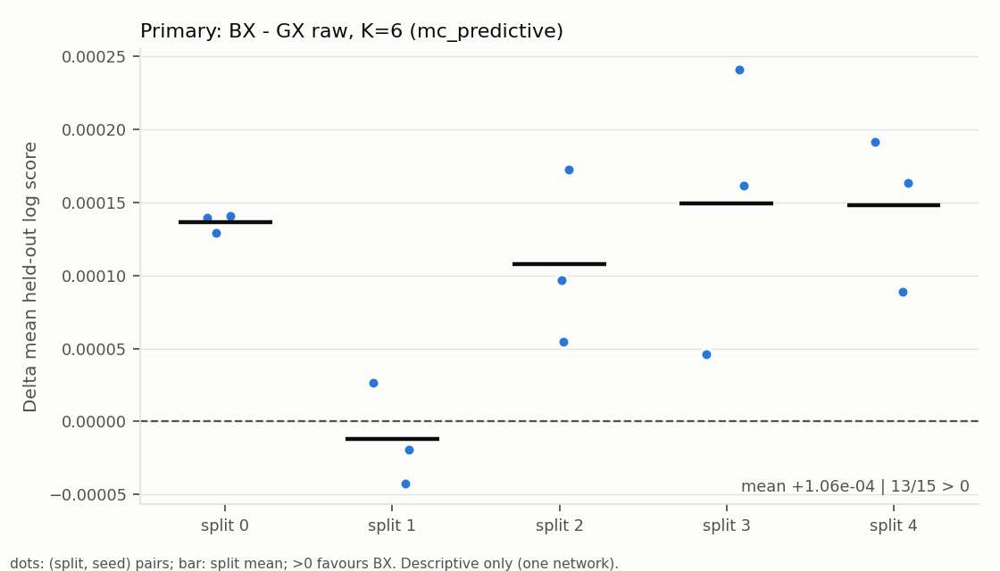

# Cora strict held-out family 比較：本実験の結果（CORA-SH1 main v2）

- 実施：2026-11-24（実行 01:24〜19:45、壁時計 67,252 秒）
- 実装系列：**lineage E（`DualExpFamLSMConsistent`）の prototype**。本文には採用できず、manuscript evidence ではない（AGENTS.md §3、§6）。
- 位置づけ：固定した計算予算（EM 8 反復、L=5）のもとでの**モデル仕様の比較**。EM は 8 反復では**収束していない**（§7）。
- 統計単位：Cora という 1 つのネットワーク。split と seed は独立な実データ標本ではない。要約は記述的なものだけで、p 値や有意性は主張しない。
- K=6 は過去の Cora 実験を根拠に選んだ。そのため本実験は完全に独立した確認実験ではない。

## 一次資料と provenance

| 項目 | 場所 |
|---|---|
| 凍結 protocol（105 fit、manifest hash `c25478e3c6c19af1`、config hash `8e4b063a057ce859`、コードの sha256） | `expfam/results/real_data/cora_strict_heldout_family_protocol_v2_20261124/protocol_frozen.json`（commit `74f874b`） |
| 実装 | `expfam/src/experimental/cora_strict_heldout.py`、`run_cora_strict_heldout_family.py`（commit `036d0b5`、test 35 件すべて通過） |
| 実行時の git head | `74f874b`（tracked tree は clean）。記録は `runinfo.json` |
| 集計スクリプト（結果を見る前に commit） | `expfam/src/experimental/analyze_cora_strict_heldout_family.py`（`005a024`）。結果を見た後に CSV の読み込み不具合だけを修正した（下記） |
| 結果 | `expfam/results/real_data/cora_strict_heldout_family_main_20261124/`。中身は `fit_technical.csv`、`heldout_scores.csv`、`f_newton_log.csv`、`mstep_q_history.csv`、`reference_scores.csv`、`split_summary.csv`（split・mask の hash）、`manifest.csv` |
| 集計と図 | 上記ディレクトリの `analysis/`（`contrast_summary.csv`、`primary_delta_*.csv`、`fig_primary_delta_K6.png`、`fig_secondary_deltas.png`、`fig_secondary_metrics_K6.png`、`failures_warnings.csv` など） |
| 学習状態（npz、50 MB） | `states/`。`*.npz` は .gitignore の対象なので commit していない。sha256 は `fit_technical.csv` の `state_sha256` に記録 |
| 事前監査 | F 更新の監査 `expfam/results/real_data/cora_strict_heldout_family_fopt_audit_20261123/`（`50f1f3e`）、smoke `..._smoke_20261123/`（`893f346`） |

**記録上の不具合（値には影響しない）**：runner は `fit_technical.csv` に 1 行ずつ追記していく。そのため、BX の行だけにある F-Newton の診断 8 列がヘッダーに入らず、BX の 30 行は 54 列、その他の 75 行は 46 列になった。集計スクリプトの `read_fit_technical` が、`run_cell` のキーの順序から列を確定的に復元する。復元時には、行の arm、`f_update`、tag と arm の対応、列数を検証している。生ファイルは変更していない。復元した表は `analysis/fit_technical_columns_restored.csv`。他の CSV は列数がそろっている。

## 条件（凍結 protocol）

- **データ**：full Cora（2708 ノード）。X は Cora 全体の列和で上位 50 語（0/1）。
- **split**：全 3,665,278 ペアから 20%（733,056 ペア）を test にする dyad split を 5 つ作った。split seed は 731000+s。test の正例は split ごとに 1033〜1076。
- **test ペアの扱い**：test ペアは mask で尤度・勾配・精度・M-step から完全に除外した。Y=0 としても学習していない。
- **arm**（Y は Bernoulli で共通）
  - BX：X を Bernoulli、raw
  - GX：X を Gaussian、raw
  - YO：Y だけ（F=0）
  - GXc：X を Gaussian、列ごとに中心化。K=6 だけで実行する secondary
- **K と seed**：K は 6（primary）と 3（sensitivity）。model seed は 3 つで、arm 間で共有。
- **F の更新**：BX は列ごとの正確な Newton 法（直線探索つき）。GX と GXc は閉形式。
- **予測と指標**
  - primary の予測は mc_predictive（最終 E-step の L=5 サンプルで確率を平均）。
  - **primary 指標**は、test ペア全体（自然な陽性率 0.14%）での平均 Bernoulli log score（1 ペアあたりの nats）。
  - **primary 比較**は Δ = log score(BX) − log score(GX raw)。K=6 で、(split, seed) ごとに対にして比べる。Δ>0 なら BX の方が良い。
- **失敗時**：fail_fast（retry・置換・seed の救済をしない）。

## 1. 実験の完了状況

**105 fit 中 105 fit が OK**。欠損・失敗・retry・置換・seed の救済はいずれも 0 だった。Python の warning、M-step での Q の減少、Laplace sampling の fallback もすべて 0。WARNING は 1 件で、§7 で説明する。1 fit あたりの時間は 31〜35 分（3 並列）。

## 2. primary Δ（BX − GX raw、K=6、mc_predictive）

| 指標 | 値 |
|---|---|
| 平均 Δ（15 対） | **+1.06×10⁻⁴** nats/pair |
| 中央値 | +1.29×10⁻⁴ |
| 範囲 | −4.2×10⁻⁵ 〜 +2.4×10⁻⁴ |
| Δ>0 の対 | 13 / 15 |
| split 平均が正の split | 4 / 5 |

比較の目安：
- 平均 log score は BX −0.009114、GX −0.009220 だった。
- 定数確率（train の密度）の baseline は −0.010831（5 split の平均）。
- GX が baseline に対して上げた分（+1.61×10⁻³）に比べると、Δ はその約 7% にあたる。
- test 733,056 ペア全体の合計に直すと、split あたり約 78 nats。

## 3. split ごとの傾向

| split | 平均 Δ | 3 seed の範囲 |
|---|---|---|
| 0 | +1.36×10⁻⁴ | +1.29〜+1.40×10⁻⁴ |
| 1 | **−1.2×10⁻⁵** | −4.2×10⁻⁵〜+2.7×10⁻⁵ |
| 2 | +1.08×10⁻⁴ | +5.4×10⁻⁵〜+1.72×10⁻⁴ |
| 3 | +1.49×10⁻⁴ | +4.6×10⁻⁵〜+2.41×10⁻⁴ |
| 4 | +1.48×10⁻⁴ | +8.9×10⁻⁵〜+1.92×10⁻⁴ |

split 1 だけ平均がわずかに負で、符号も seed によって変わる。残りの 4 split では、3 seed すべてで Δ が正だった。seed による変動（split 内の幅）は、split 間の差と同じくらいの大きさがある。

## 4. K=3 の感度分析

BX − GX raw（K=3）は平均 **+1.14×10⁻⁴** で、Δ>0 は 13/15 対、split 平均は 5/5 split で正だった（ただし split 1 は +1×10⁻⁶ でほぼ 0）。K=6 とほぼ同じ大きさ・同じ符号である。

## 5. GXc（secondary、K=6）

| 比較 | 平均 Δ | Δ>0 | 正の split |
|---|---|---|---|
| BX − GXc | **−4.4×10⁻⁵** | 3 / 15 | 1 / 5 |
| GXc − GX raw | **+1.50×10⁻⁴** | 15 / 15 | 5 / 5 |

GX を中心化した GXc は、平均 log score が −0.009070 で K=6 の 4 arm の中で最も高かった。BX より平均で 4.4×10⁻⁵ 良い。Gaussian のまま中心化するだけで GX raw との差が消え、さらに逆転している。Z の平均ノルムは GXc 0.08、YO 0.06 に対して、BX 0.67、GX 0.70 だった。中心化すると、X の平均を Z の平行移動で吸収する必要がなくなることと整合する。

## 6. Y-only との比較

| 比較 | K=6 | K=3 |
|---|---|---|
| BX − YO | +3.57×10⁻⁴（15/15） | +6×10⁻⁶（7/15、ほぼ 0） |
| GX − YO | +2.51×10⁻⁴（15/15） | **−1.08×10⁻⁴**（1/15） |

K=6 では、X を使った両方の arm が全 15 対で YO を上回った。K=3 では、BX は YO とほぼ同じで、GX raw は YO より悪かった。X を使う利点が出るかどうかは K によって変わる。

## secondary 指標（K=6、mc_predictive、BX − GX raw）

| 指標 | 平均 Δ | BX の方が良い対 |
|---|---|---|
| AUC | +0.0079 | 13/15 |
| AP | +0.0030 | 12/15 |
| Brier（低いほど良い） | −2.7×10⁻⁶ | 12/15 |
| 正例の log score | +0.060 | 12/15 |
| 負例の log score | +1.9×10⁻⁵ | 15/15 |

K=6 の arm ごとの平均は次のとおり。

| arm | AUC | AP |
|---|---|---|
| BX | 0.845 | 0.0435 |
| GX | 0.837 | 0.0406 |
| GXc | 0.850 | 0.0450 |
| YO | 0.791 | 0.0413 |

どの arm も、予測確率の平均（約 0.0016）が test の陽性率（0.00144）をわずかに上回っている。

**plug-in 推定量での結果**（既定の secondary、log score の Δ、K=6）：
- 最後の 5 サンプルの平均（mean5）では +1.14×10⁻⁴（13/15）で、primary と同じ向き。
- 最終サンプル 1 つ（last）では **−1.7×10⁻⁵（9/15、正の split は 2/5）** で、向きがそろわない。

primary の結果は、MC で平均した予測で評価したときのものである。最終サンプル 1 つの点推定では、同じ向きにはならない。

## 7. 最適化と収束の診断（技術面。科学的な結果とは分けて扱う）

- **BX の F（Newton 法）**
  - 240 回の M-step のうち 239 回が収束した。Q_X が下がった回、直線探索が失敗した回はいずれも 0。
  - 最終勾配の最大値は 2.5×10⁻⁵、Hessian の最小固有値は 2.4 以上だった。
  - 完全分離は起きていない。ただし |η| の最大は 37〜40 と、極端な線形予測子が出ている。
- **WARNING 1 件**：s2-K6-r0-BX の M-step 1 が反復上限（100 回）に達した。
  - その時点で勾配は 2.5×10⁻⁵、Hessian の最小固有値は 290、Q_X は −93,319 から −74,835 へ改善していた。
  - 停止条件（λ²/2 < 10⁻¹²）が非常に厳しいことによるもので、実質的には最適点に達している。BLOCKER とは扱わない。
- **GX と GXc**：σ²（分散）の最小値は 0.045〜0.052 で、精度は最大で約 22。
- **EM は未収束**
  - 8 反復目でも 1 反復あたりの Q の増分は正のまま。中央値は次のとおり。

| K | BX | GX | GXc | YO |
|---|---|---|---|---|
| 6 | 329 | 138 | 157 | 71 |
| 3 | 119 | 68 | — | 36 |

  - 全体の中央値は、1 反復目の 22,396 から 8 反復目の 118 まで単調に減っている。
  - **BX は他の arm より Q の増分が大きく、まだ伸び続けている**。arm によって収束の度合いが違うので、固定予算での比較には交絡が残る。
- **mask と漏洩**
  - test を全 0 にした場合と全 1 にした場合で fit が一致すること（合成データと実データの両方）を確かめた。
  - 各 split の mask の hash は `split_summary.csv` に記録した。
  - 実行時の tracked tree は clean だった。

## 8. 科学的に言えること（OBSERVED と INTERPRETATION を分けて書く）

- **OBSERVED**
  - lineage E の現行仕様、固定予算（8 反復、L=5）、full Cora、上位 50 語の条件で、BX raw の held-out log score は GX raw をわずかに上回った（K=6 で +1.06×10⁻⁴ nats/pair、13/15 対、4/5 split）。
  - K=3 でも同じ向きで、AUC・AP・Brier も同じ向きだった。
- **OBSERVED**
  - 事前に登録した secondary の GXc（中心化した Gaussian）は BX を上回った（−4.4×10⁻⁵）。
  - GXc は GX raw より、全 15 対で良かった。
- **INTERPRETATION**
  - BX が GX raw に勝った分は、「Bernoulli が 0/1 データに対して正しい分布だから」とは帰属できない。
  - 切片がない仕様のもとで、X の平均をどう扱うかが主な要因と考えるのが妥当である（中心化だけで差が消え、逆転する）。
- **OBSERVED**
  - K=6 では、X を加えると（BX、GX とも）Y-only より held-out の log score が良くなった。
  - K=3 ではその効果がなかった。GX raw は Y-only より悪かった。

## 9. 言えないこと

- 分布が正しいことによる純粋な効果（中心化、X の重み、最適化・収束の違いと交絡している）。
- 統計的有意性、Cora 以外のネットワークや属性セットへの一般化（ネットワークは 1 つだけ）。
- EM が収束した最尤推定どうしの比較（8 反復では未収束で、arm によって収束の度合いが違う）。
- 予測方法によらない結論（最終サンプル 1 つの plug-in では向きがそろわない）。
- 完全に独立な確認実験であること（K=6 は過去の Cora 実験に基づく）。
- manuscript evidence であること（lineage E の prototype。採用には Human Gate が要る）。
- K=3 と GXc の位置づけを、結果を見て primary に格上げすること。

## 10. 修士論文での使い道（案。決めるのは研究者）

- 実データの事例研究として書ける候補：「現行の X family 仕様を Cora の strict held-out（全ペアの dyad split、test ペアを mask で除外）で比べ、固定予算のもとでの記述的な比較を行った」。
- 主なメッセージは「Bernoulli が良い」ではない。むしろ次の 2 点である。
  1. X の family の違いによる予測の差は小さい（定数 baseline に対する改善分の 1 割未満）。
  2. その差は、中心化の有無、つまり切片がない仕様に強く左右される。
- これは、一般化モデルの有効条件と限界を示す結果として使える。
- 本文に採用する場合は、lineage E を正式な系列に昇格させること、Adam から Newton 法への変更、EM が未収束であることの扱いについて、Human Gate が必要になる。
